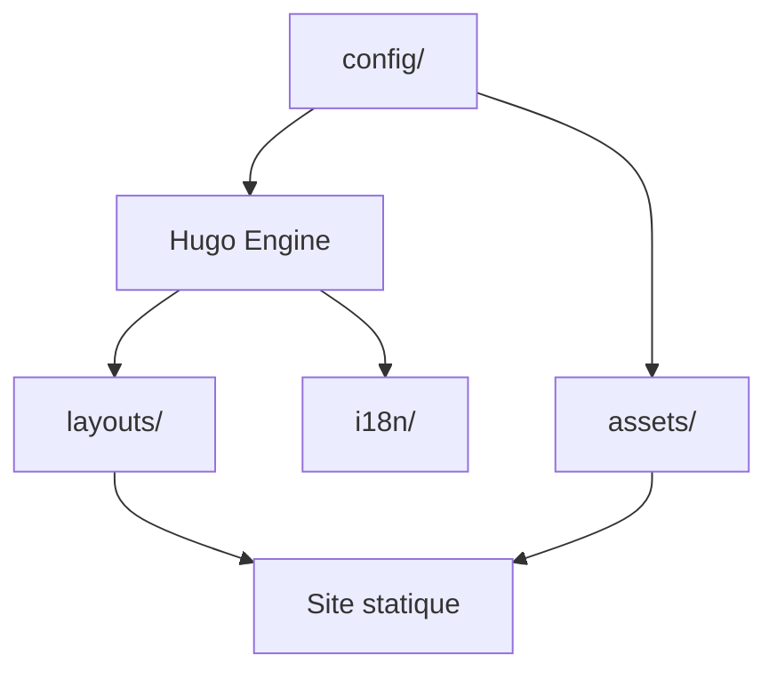

# theNewDynamic/gohugo-theme-ananke

> Starter theme for Hugo, focused on accessibility and maintainable defaults.

## The problem
Starting a Hugo site requires a complete theme: templates, styles, translations and SEO settings.

## What it actually does
Provides responsive templates, a configurable header, social links, an optional contact form, translations, default SEO values and reading time. It installs as a Hugo module (recommended) or a Git submodule. The repository moved on April 23, 2026 to `github.com/gohugo-ananke/ananke`.

## How it is wired


## Trying it
```bash
hugo mod tidy
git submodule sync
```
Commands from the README, meant for the migration to the repository's new address.

## Cost and gotchas
Free. Hugo required (not listed in the prerequisites). Update the references to the new organization.

## What it is not
Not a site generator: you need Hugo. External integrations (comments, forms) remain to be configured.

## Alternatives
No alternative named in the README.

## For you
Ignore: a website theme, unrelated to data, AI or MLOps work, except for a personal blog on Hugo.
