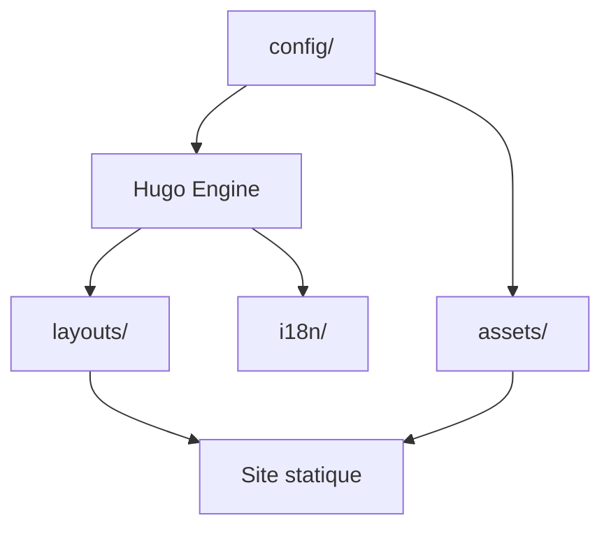

# theNewDynamic/gohugo-theme-ananke

> Thème de départ pour Hugo, centré sur l'accessibilité et des réglages par défaut maintenables.

## Le problème
Démarrer un site Hugo exige un thème complet : gabarits, styles, traductions et réglages SEO.

## Ce que ça fait vraiment
Fournit des gabarits réactifs, un en-tête configurable, des liens sociaux, un formulaire de contact optionnel, des traductions, des valeurs SEO par défaut et le temps de lecture. Il s'installe comme module Hugo (recommandé) ou sous-module Git. Le dépôt a migré le 23 avril 2026 vers `github.com/gohugo-ananke/ananke`.

## Comment c'est branché


## Essayer
```bash
hugo mod tidy
git submodule sync
```
Commandes du README, destinées à la migration vers la nouvelle adresse du dépôt.

## Coût et pièges
Gratuit. Hugo requis (non listé dans les prérequis). Mettre à jour les références vers la nouvelle organisation.

## Ce que ce n'est pas
Pas un générateur de site : il faut Hugo. Les intégrations externes (commentaires, formulaires) restent à configurer.

## Alternatives
Aucune alternative nommée dans le README.

## Pour toi
Ignorer : un thème de site web, sans lien avec un travail data, IA ou MLOps, sauf pour un blog personnel sous Hugo.

