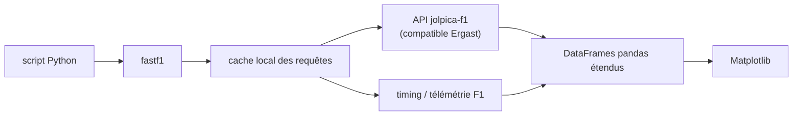

# theOehrly/Fast-F1

> Python library for accessing Formula 1 lap times, telemetry and results, as DataFrames.

## The problem
F1 timing and telemetry data are scattered across several endpoints and formats;
fetching and aligning them yourself in every script costs more time than the analysis.

## What it actually does
Exposes sessions, results, schedules, timing and telemetry as extended pandas DataFrames, with methods added on pandas objects specifically for F1 data. Supports the `jolpica-f1` API, Ergast-compatible, for history and the current season. Caches all API requests so that repeated scripts do not call the source again. Integrates Matplotlib for visualization.

## How it is wired


## Trying it
```bash
pip install fastf1
# ou
conda install -c conda-forge fastf1
```

## Cost and gotchas
Free, no key. The real cost is the dependency on a third-party API (`jolpica-f1`) and on the timing feed: if the source changes or goes down, scripts stop. The disk cache grows quickly.

## What it is not
Not an official product: the README states that the project is not associated in any way with the Formula 1 companies, and that the trademarks belong to Formula One Licensing B.V. No guarantee of working under Pyodide / JupyterLite: compatibility is announced but not thoroughly tested.

## Alternatives
- `jolpica-f1` directly: if you want the raw API without the pandas layer.
- `f1dataR` (CRAN): an R wrapper around FastF1, for those who work in R.

## For you
An excellent pandas/viz training ground with real, clean, free data.
