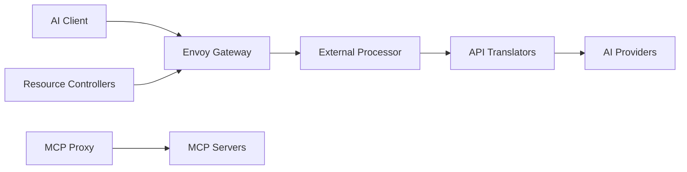

# theagentrouter/agent-router

> Open source, Envoy-based control plane for AI and agent traffic (formerly Envoy AI Gateway).

## The problem
Application teams multiply keys and model providers; the platform wants to centralize routing, quotas, failover and cost attribution.

## What it actually does
A single OpenAI-compatible API in front of hosted models, self-hosted inference and MCP servers. On Kubernetes, CRDs (`AIGatewayRoute`, `AIServiceBackend`, `BackendSecurityPolicy`) are reconciled into Envoy Gateway configuration. An external processor authenticates, translates APIs, applies quotas and measures usage; an MCP proxy handles that traffic. An `aigw run` CLI launches it standalone. Two-tier design: an ingress gateway and a model-cluster gateway.

## How it is wired


## Trying it
```bash
OPENAI_API_KEY=sk-your-key aigw run
```
Then point an OpenAI-compatible client at `http://localhost:1975/v1`.

## Cost and gotchas
The full mode assumes Kubernetes and Envoy Gateway. Provider keys are at your expense. 299 open issues. Technical names (CRDs, images, Go module) did not change despite the renaming.

## What it is not
Not an agent manager nor an inference engine: it routes and controls traffic.

## Alternatives
- No alternative named in the README.

## For you
Watch: relevant for a multi-model MLOps platform on Kubernetes; oversized for individual use.
