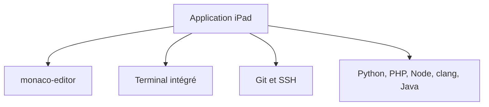

# thebaselab/codeapp

> Code editor for iPad that reproduces the VS Code experience with terminal, Git and local languages.

## The problem
Programming on an iPad lacks a desktop-like environment, with version control and local execution.

## What it actually does
The app, available on the App Store and TestFlight, is inspired by VS Code and relies on monaco-editor and native code. The README lists: Git (clone, commit, diff, push, pull), integrated terminal (more than 70 commands), local web environment (Node and PHP), Python, C and C++ via WebAssembly with clang, Java (OpenJDK), SSH and LSP for Python and Java.

## How it is wired
Simplified diagram based on the sheet, no diagram provided.


## Trying it
```bash
git clone https://github.com/thebaselab/codeapp
./downloadFrameworks.sh
```

## Cost and gotchas
Free for the code (MIT); the App Store price is not specified. Building goes through Xcode (open `Code.xcodeproj`). 582 open issues. The embedded language versions are old (Python 3.9.2, Node 18, OpenJDK 8).

## What it is not
Not VS Code: it is an imitation of its design with its own features. Not suited to heavy compute workloads on a tablet.

## Alternatives
No alternative named in the README.

## For you
Ignore: an iPad editor useful for coding on the move, but the old Python runtimes and the lack of GPU compute do not suit data or AI work.
