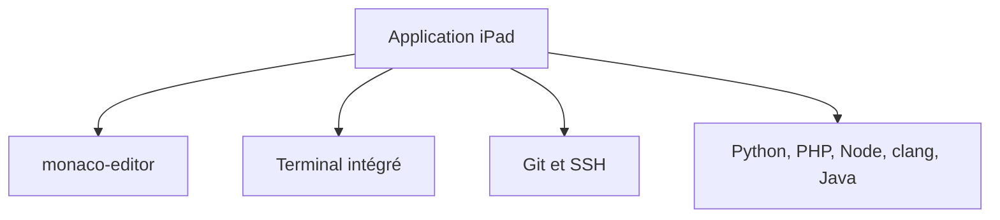

# thebaselab/codeapp

> Éditeur de code pour iPad qui reprend l'expérience de VS Code avec terminal, Git et langages locaux.

## Le problème
Programmer sur iPad manque d'un environnement proche du bureau, avec contrôle de version et exécution locale.

## Ce que ça fait vraiment
L'application, disponible sur l'App Store et TestFlight, s'inspire de VS Code et s'appuie sur monaco-editor et du code natif. Le README annonce : Git (clone, commit, diff, push, pull), terminal intégré (plus de 70 commandes), environnement web local (Node et PHP), Python, C et C++ via WebAssembly avec clang, Java (OpenJDK), SSH et LSP pour Python et Java.

## Comment c'est branché
Schéma simplifié d'après la fiche, sans diagramme fourni.


## Essayer
```bash
git clone https://github.com/thebaselab/codeapp
./downloadFrameworks.sh
```

## Coût et pièges
Gratuit pour le code (MIT) ; le prix sur l'App Store n'est pas précisé. La compilation passe par Xcode (ouvrir `Code.xcodeproj`). 582 issues ouvertes. Les versions des langages embarqués sont anciennes (Python 3.9.2, Node 18, OpenJDK 8).

## Ce que ce n'est pas
Ce n'est pas VS Code : c'est une imitation de son design avec des fonctions propres. Il n'est pas adapté à des charges lourdes de calcul sur tablette.

## Alternatives
Aucune alternative nommée dans le README.

## Pour toi
À ignorer : éditeur iPad utile pour du code en mobilité, mais les runtimes Python anciens et l'absence de calcul GPU ne conviennent pas à un travail data ou IA.

