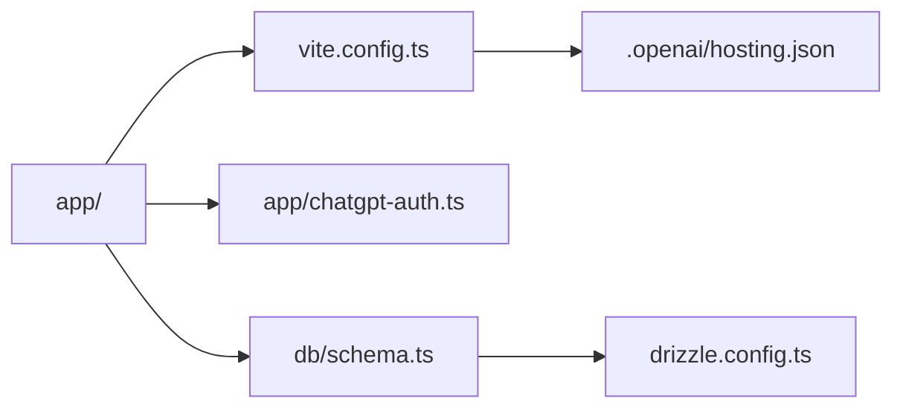

# thebuggeddev/anatomy

> Full-stack vinext template with optional Cloudflare D1 and Drizzle, for sites hosted in the OpenAI ecosystem.

## The problem
Starting a deployable full-stack site with a database requires setting up the framework, schema and authentication by hand.

## What it actually does
The README describes a starter named vinext-starter, whose site code lives under `app/`. It declares optional D1 and R2 bindings in `.openai/hosting.json`, simulated locally by `vite.config.ts`. It provides helpers to read a user's identity via OpenAI headers and for sign-in with ChatGPT. The database schema is empty.

## How it is wired
Simplified diagram based on the write-up, no diagram provided.


## Trying it
```bash
npm install
npm run dev
npm run build
```

## Cost and gotchas
Node 22.13 or later. Deployment and authentication depend on OpenAI's Sites hosting platform (Dispatch), which owns the sign-in routes. No license declared: use is not explicitly permitted.

## What it is not
Not a tool named "anatomy" according to the README: the content is a template unrelated to its name. It is not a long-term maintained project (last push in August 2026).

## Alternatives
No alternative named in the README.

## For you
Ignore: a web template tied to a specific hosting platform, with no license, of no interest to a data / AI / MLOps profile.
