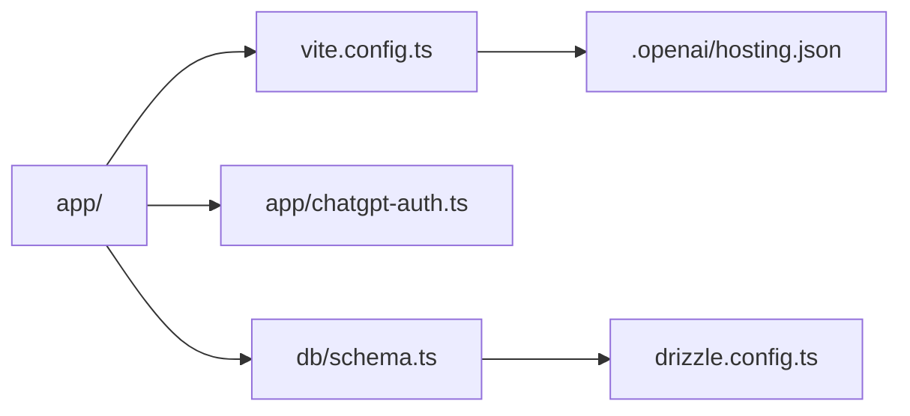

# thebuggeddev/anatomy

> Gabarit full-stack vinext avec Cloudflare D1 et Drizzle optionnels, pour sites hébergés dans l'écosystème OpenAI.

## Le problème
Démarrer un site full-stack déployable avec base de données demande de monter à la main le framework, le schéma et l'authentification.

## Ce que ça fait vraiment
Le README décrit un starter nommé vinext-starter, dont le code du site vit sous `app/`. Il déclare des liaisons D1 et R2 optionnelles dans `.openai/hosting.json`, simulées en local par `vite.config.ts`. Il fournit des helpers pour lire l'identité d'un utilisateur via des en-têtes OpenAI et pour la connexion avec ChatGPT. Le schéma de base est vide.

## Comment c'est branché
Schéma simplifié d'après la fiche, sans diagramme fourni.


## Essayer
```bash
npm install
npm run dev
npm run build
```

## Coût et pièges
Node 22.13 ou plus. Le déploiement et l'authentification dépendent de la plateforme d'hébergement Sites d'OpenAI (Dispatch), qui possède les routes de connexion. Aucune licence déclarée : l'usage n'est pas autorisé explicitement.

## Ce que ce n'est pas
Pas un outil nommé « anatomy » d'après le README : le contenu est un gabarit sans rapport avec son nom. Ce n'est pas un projet maintenu à long terme (dernier push en août 2026).

## Alternatives
Aucune alternative nommée dans le README.

## Pour toi
À ignorer : gabarit web lié à une plateforme d'hébergement précise, sans licence, sans intérêt pour un profil data / IA / MLOps.

