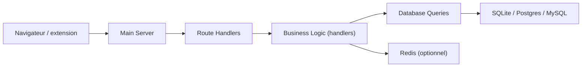

# thedevs-network/kutt

> Self-hostable URL shortener with custom domains, statistics and user management.

## The problem
SaaS shorteners impose their domain and quotas, and keep your click statistics.

## What it actually does
Node.js server (Express, Handlebars views): creation and editing of links with password, expiration and description, private statistics, an admin page, a REST API, OIDC login. SQLite by default, Postgres or MySQL optionally, Redis for caching. Queues and cron jobs run in the background.

## How it is wired


## Trying it
```bash
npm install
npm run migrate
npm start
docker compose up
```

## Cost and gotchas
`JWT_SECRET` is mandatory in production. Sign-up is disabled by default and depends on email (`MAIL_ENABLED`). Certificates for custom domains must be generated yourself. The `kutt.it` domain no longer belongs to the project (phishing warning in the README).

## What it is not
Not a full web-analytics tool: only click statistics. Custom views may break with each update.

## Alternatives
No alternative named in the README.

## For you
Ignore for a data/AI profile: it is a generic web application, useful only if you want to self-host short links.
