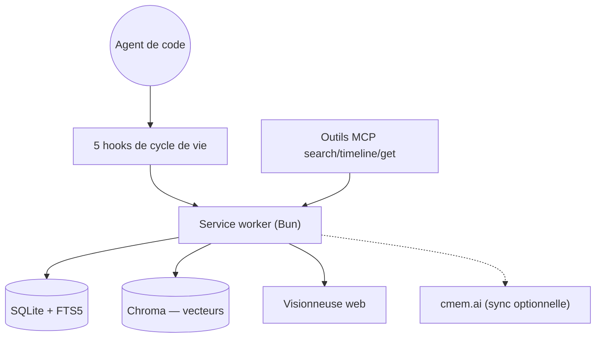

# thedotmack/claude-mem

> Persistent caching for code agents, with hybrid local search.

## The problem
Each session starts from scratch: the agent re-learns the project, past decisions, and known pitfalls.
Manually copying a summary each time doesn't scale effectively.

## What it actually does
Five lifecycle hooks capture tool usage observations and generate semantic summaries.
A local service worker (Bun) exposes an HTTP API, a web interface for memory streams, and search endpoints.
SQLite storage with FTS5 full-text search, plus Chroma for hybrid vector search.
Four MCP tools in three layers – `search` (indexing), `timeline` (context), `get_observations` (details) – to limit tokens.

## How it is wired


## Trying it
```bash
npx claude-mem install
npx claude-mem install --ide opencode
ls ~/.claude/plugins/marketplaces/thedotmack/plugin/modes/
```

## Cost and gotchas
The default memory provider is hosted (CMEM Pro), which is free for 30 days and then requires payment; `--provider host` remains local.
The installer requires a connection via a magic link; `CLAUDE_MEM_ONLINE_OPTIN=false` bypasses this.

## What it is not
Not purely local by default – observations are directed towards a third-party service unless explicitly configured.
`npm install -g claude-mem` only installs the library, not the hooks or worker.
The README associates the project with a cryptographic token "CMEM"; no license is declared.

## Alternatives
- `NousResearch/hermes-agent`: Memory and recall are integrated directly into the agent, rather than being added on top of it.
- `Graphify-Labs/graphify`: Instead of storing session data, this project focuses on mapping the repository.

## For you
The idea is good, but the packaging is concerning (default SaaS model, token-based, no license). This warrants close monitoring.
