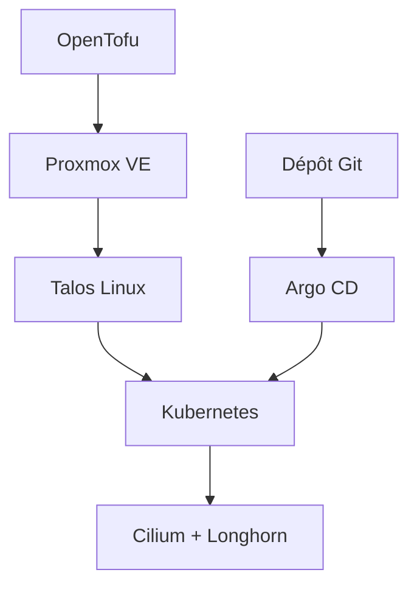

# theepicsaxguy/homelab

> GitOps repository of a Kubernetes homelab (Proxmox, Talos, Argo CD), to read as a reference.

## The problem
Rebuilding a homelab by hand after every failure wastes time; describing everything as code makes it possible to recreate it.

## What it actually does
- Describes the whole cluster in Git: virtual machines with OpenTofu, Talos OS, applications deployed by Argo CD.
- Networking with Cilium, storage with Longhorn, secrets via External Secrets and Bitwarden, SSO with Authentik.
- Certificates with cert-manager, PostgreSQL with CloudNativePG, Kubechecks checks, Cloudflared tunnel.
- Folders: `k8s`, `tofu`, `images`, `website`.

## How it is wired
Simplified diagram based on the sheet, no diagram provided.

## Trying it
No command really documented: the README points to the Quick Start guide and lists the tools to install (`opentofu`, `talosctl`, `kubectl`, `argocd`).

## Cost and gotchas
Hardware at your expense: the author uses a Dell Precision 7810 (78 GB of RAM) and a NAS. You need Proxmox access with an SSH key and some Kubernetes experience.

## What it is not
Not a turnkey product: the README asks you to adapt it, as the configuration is specific to his hardware. Not designed for AI or GPU compute.

## Alternatives
No alternative mentioned, apart from Vehagn's homelab, which it draws inspiration from.

## For you
Worth watching as an example of complete GitOps to learn the platform beneath your workloads; to adapt, never to copy as is.
