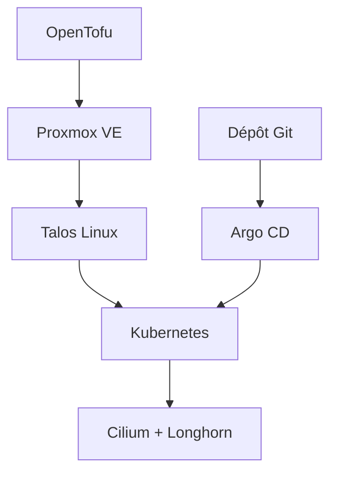

# theepicsaxguy/homelab

> Dépôt GitOps d'un homelab Kubernetes (Proxmox, Talos, Argo CD), à lire comme référence.

## Le problème
Reconstruire un homelab à la main à chaque panne fait perdre du temps ; tout décrire en code permet de le recréer.

## Ce que ça fait vraiment
- Décrit tout le cluster dans Git : machines virtuelles avec OpenTofu, OS Talos, applications déployées par Argo CD.
- Réseau avec Cilium, stockage Longhorn, secrets via External Secrets et Bitwarden, SSO avec Authentik.
- Certificats avec cert-manager, PostgreSQL avec CloudNativePG, contrôles Kubechecks, tunnel Cloudflared.
- Dossiers : `k8s`, `tofu`, `images`, `website`.

## Comment c'est branché
Schéma simplifié d'après la fiche, sans diagramme fourni.

## Essayer
Aucune commande réellement documentée : le README renvoie au guide Quick Start et liste les outils à installer (`opentofu`, `talosctl`, `kubectl`, `argocd`).

## Coût et pièges
Matériel à ta charge : l'auteur utilise un Dell Precision 7810 (78 Go de RAM) et un NAS. Il faut un accès Proxmox avec clé SSH et un peu d'expérience Kubernetes.

## Ce que ce n'est pas
Pas un produit clé en main : le README demande de l'adapter, la configuration étant propre à son matériel. Pas pensé pour l'IA ni le calcul GPU.

## Alternatives
Aucune alternative citée, à part le homelab de Vehagn, dont il s'inspire.

## Pour toi
À surveiller comme exemple de GitOps complet pour apprendre la plateforme sous tes workloads ; à adapter, jamais à copier tel quel.

