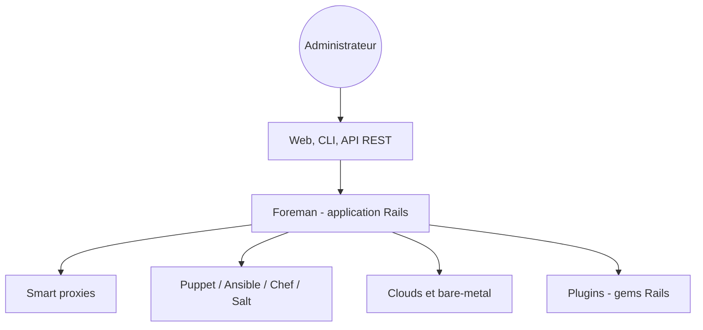

# theforeman/foreman

> Free platform for provisioning and lifecycle management of servers, physical or cloud, for administrators.

## The problem
Managing tens to thousands of servers by hand (installation, configuration, updates, audit) becomes unmanageable and inconsistent.

## What it actually does
Foreman discovers and provisions bare machines, creates instances on private and public clouds, groups hosts and keeps a history of changes for audit. It relies on Puppet, Ansible, Chef or Salt and on its "smart proxies". It offers a web interface, a CLI and a REST API documented with apipie, plus LDAP and RBAC. Plugins are Rails engines distributed as gems.

## How it is wired
Simplified diagram based on the fiche, no diagram provided.

## Trying it
No command documented in the README: read the quickstart section of the Foreman manual.

## Cost and gotchas
Free. Heavy setup: Rails, a database, proxies, and a configuration tool on top. GPL v3 or later license, with listed exceptions for a few files.

## What it is not
It is not Ruby's Foreman that launches processes from the CLI: the README warns about this similar name. It is not an MLOps tool nor a container orchestrator.

## Alternatives
No alternative named in the README.

## For you
Ignore, unless you administer a server fleet: it manages machines, not models or data pipelines.
