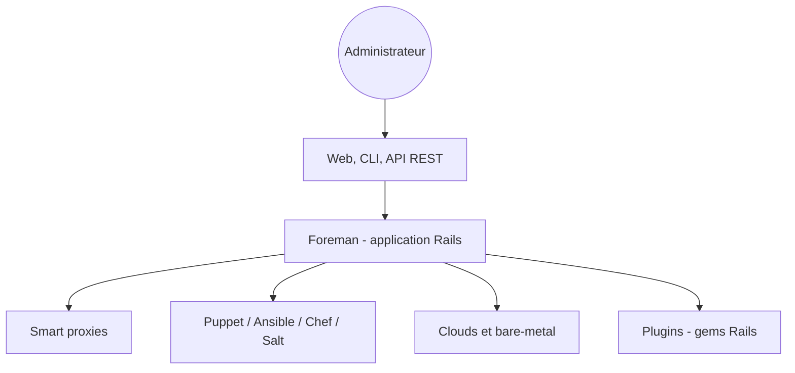

# theforeman/foreman

> Plateforme libre de provisionnement et de gestion du cycle de vie de serveurs, physiques ou cloud, pour administrateurs.

## Le problème
Gérer des dizaines à des milliers de serveurs à la main (installation, configuration, mise à jour, audit) devient ingérable et incohérent.

## Ce que ça fait vraiment
Foreman découvre et provisionne des machines nues, crée des instances sur des clouds privés et publics, groupe les hôtes et garde un historique des changements pour l'audit. Il s'appuie sur Puppet, Ansible, Chef ou Salt et sur ses « smart proxies ». Il offre interface web, CLI et API REST documentée par apipie, plus LDAP et RBAC. Les plugins sont des moteurs Rails distribués en gems.

## Comment c'est branché
Schéma simplifié d'après la fiche, sans diagramme fourni.

## Essayer
Aucune commande documentée dans le README : lire la section quickstart du manuel Foreman.

## Coût et pièges
Gratuit. Mise en place lourde : Rails, base de données, proxies, et un outil de configuration en plus. Licence GPL v3 ou ultérieure, avec exceptions listées pour quelques fichiers.

## Ce que ce n'est pas
Ce n'est pas le Foreman de Ruby qui lance des processus en CLI : le README prévient de ce nom proche. Ce n'est pas un outil MLOps ni un orchestrateur de conteneurs.

## Alternatives
Aucune alternative nommée dans le README.

## Pour toi
À ignorer, sauf si tu administres un parc de serveurs : il gère des machines, pas des modèles ni des pipelines de données.

