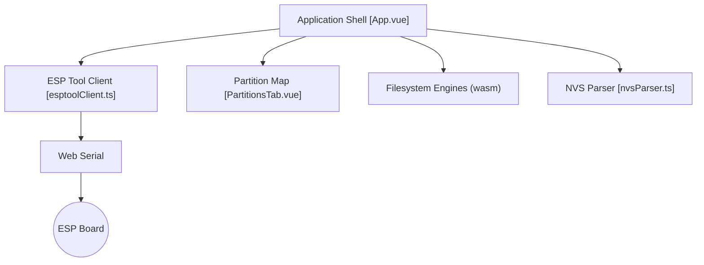

# thelastoutpostworkshop/ESPConnect

> Browser-based control center to inspect, back up and flash ESP32 and ESP8266 boards.

## The problem
Flashing, backing up or inspecting an ESP board requires command-line tools to be installed.

## What it actually does
Via Web Serial in Chrome or Edge: chip info, partition table, OTA slots, `.bin` flashing, partition backup, MD5 checksum, register access, serial console, session log. Handles SPIFFS/FAT/LittleFS files and a read-only, experimental NVS inspector. ESP8266: very limited support.

## How it is wired


## Trying it
```bash
docker build -t espconnect .
docker run --rm -p 8080:80 espconnect
```
Otherwise, open the stable version: https://thelastoutpostworkshop.github.io/ESPConnect/

## Cost and gotchas
Free. Requires a Chromium 89+ browser and a USB cable with data lines. Without automatic reset wiring, entering the bootloader is manual.

## What it is not
Not an IDE nor a build tool. The NVS inspector is not reliable for recovery or forensics (the README says so). No partition access on ESP8266.

## Alternatives
The project is based on Jason2866's WebSerial ESPTool; no other alternative cited.

## For you
Watch: very handy if you touch IoT or edge, with no direct link to data/AI/MLOps. No telemetry or backend announced.
