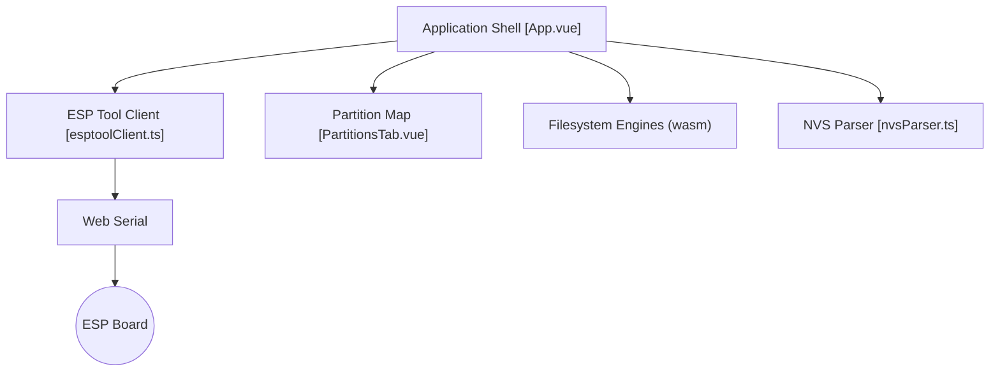

# thelastoutpostworkshop/ESPConnect

> Centre de contrôle dans le navigateur pour inspecter, sauvegarder et flasher des cartes ESP32 et ESP8266.

## Le problème
Flasher, sauvegarder ou inspecter une carte ESP demande des outils en ligne de commande à installer.

## Ce que ça fait vraiment
Via Web Serial dans Chrome ou Edge : infos de la puce, table des partitions, emplacements OTA, flash de `.bin`, sauvegarde de partitions, somme MD5, accès aux registres, console série, journal de session. Gère les fichiers SPIFFS/FAT/LittleFS et un inspecteur NVS en lecture seule, expérimental. ESP8266 : support très limité.

## Comment c'est branché


## Essayer
```bash
docker build -t espconnect .
docker run --rm -p 8080:80 espconnect
```
Sinon, ouvrir la version stable : https://thelastoutpostworkshop.github.io/ESPConnect/

## Coût et pièges
Gratuit. Il faut un navigateur Chromium 89+, un câble USB avec lignes de données. Sans câblage de reset automatique, la mise en bootloader est manuelle.

## Ce que ce n'est pas
Pas un IDE ni un outil de compilation. L'inspecteur NVS n'est pas fiable pour de la récupération ou de la forensique (le README le dit). Pas d'accès aux partitions sur ESP8266.

## Alternatives
Le projet se base sur le WebSerial ESPTool de Jason2866 ; aucune autre alternative citée.

## Pour toi
Surveiller : très pratique si tu touches à de l'IoT ou de l'edge, sans rapport direct avec data/IA/MLOps. Pas de télémétrie ni de backend annoncés.

