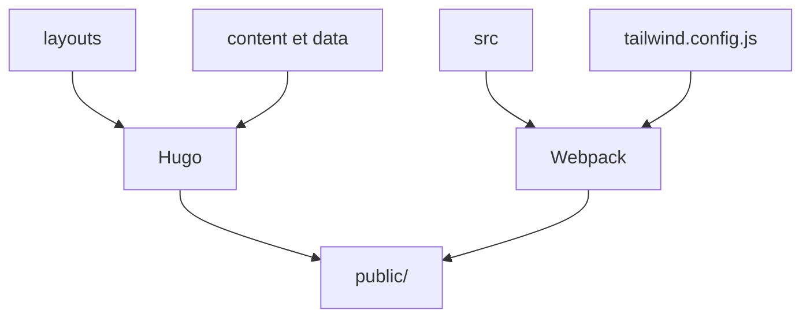

# themesberg/flowbite-admin-dashboard

> Admin dashboard template in Tailwind CSS and Flowbite, generated with Hugo.

## The problem
Building a back office with tables, forms, login pages and charts takes a lot of repetitive HTML and CSS.

## What it actually does
The repository provides fifteen example pages: two home pages with charts and statistics, two CRUD pages (products, users), settings, authentication, 404 and 500 errors. Components come from Flowbite, charts from ApexCharts, styling from Tailwind v3. The site is built with Hugo and Webpack.

## How it is wired


## Trying it
```bash
npm install
npm run start
npm run build
```

## Cost and gotchas
Free, but Node and npm are required. The last push dates from March 2025 and the README targets Tailwind v3: upgrading to v4 would be on you.

## What it is not
It is not an application with a back end: these are static demo pages to copy into your stack. Nothing to do with data or AI.

## Alternatives
The Flowbite libraries for React, Vue, Svelte and Angular, cited in the README, if you already work with one of those frameworks.

## For you
Ignore: generic front-end template, off-topic for a data / AI / MLOps profile, and not updated for over a year.
