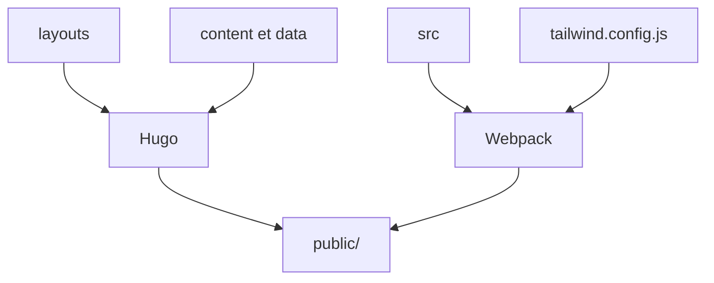

# themesberg/flowbite-admin-dashboard

> Modèle de tableau de bord d'administration en Tailwind CSS et Flowbite, généré avec Hugo.

## Le problème
Monter un back-office avec tableaux, formulaires, pages de connexion et graphiques demande beaucoup de HTML et de CSS répétitifs.

## Ce que ça fait vraiment
Le dépôt fournit quinze pages d'exemple : deux accueils avec graphiques et statistiques, deux pages CRUD (produits, utilisateurs), paramètres, authentification, erreurs 404 et 500. Les composants viennent de Flowbite, les graphiques d'ApexCharts, le style de Tailwind v3. Le site se construit avec Hugo et Webpack.

## Comment c'est branché


## Essayer
```bash
npm install
npm run start
npm run build
```

## Coût et pièges
Gratuit, mais Node et npm sont nécessaires. Le dernier push date de mars 2025 et le README cible Tailwind v3 : une montée vers v4 serait à ta charge.

## Ce que ce n'est pas
Ce n'est pas une application avec un back-end : ce sont des pages statiques de démonstration à recopier dans ta pile. Rien à voir avec des données ou de l'IA.

## Alternatives
Les bibliothèques Flowbite pour React, Vue, Svelte et Angular, citées dans le README, si tu travailles déjà avec un de ces frameworks.

## Pour toi
À ignorer : gabarit front générique, hors sujet pour un profil data / IA / MLOps, et plus mis à jour depuis plus d'un an.

