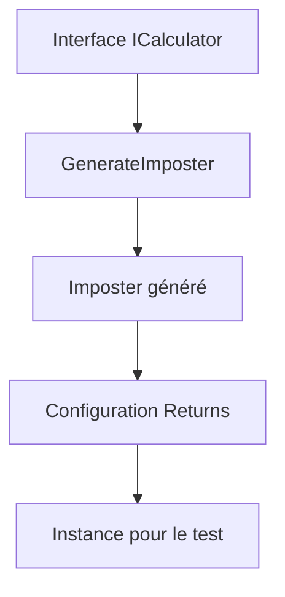

# themidnightgospel/Imposter

> Fast, strongly typed mocking library for .NET tests, generated at compile time.

## The problem
Classic .NET mocking libraries are slow or rely on weakly typed callbacks.

## What it actually does
A `[GenerateImposter]` attribute generates a mock at compile time for an interface or an unsealed class. You configure methods, properties, events and indexers, with implicit or explicit modes. The README claims about 10 times NSubstitute and 50 times Moq, without being the fastest.

## How it is wired
Simplified diagram based on the sheet, no diagram provided.



## Trying it
```bash
dotnet add package Imposter
```
```csharp
[assembly: GenerateImposter(typeof(Application.Domain.ICalculator))]
var imposter = ICalculator.Imposter();
```

## Cost and gotchas
Free. You need .NET, which is missing from the prerequisites list. Performance figures are provided by the author, on shared machines.

## What it is not
Not a complete test framework: it only replaces the dependencies of a test.

## Alternatives
NSubstitute and Moq, compared in the README, slower.

## For you
Ignore: .NET ecosystem, outside the Python and AI of your profile.
