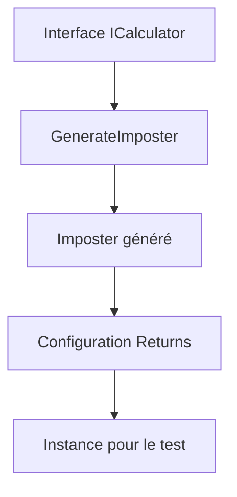

# themidnightgospel/Imposter

> Bibliothèque de mocks pour tests .NET, rapide et fortement typée, générée à la compilation.

## Le problème
Les bibliothèques de mocks .NET classiques sont lentes ou reposent sur des callbacks faiblement typés.

## Ce que ça fait vraiment
Un attribut `[GenerateImposter]` génère à la compilation un mock pour une interface ou une classe non scellée. Tu configures méthodes, propriétés, événements et indexeurs, avec modes implicite ou explicite. Le README annonce environ 10 fois NSubstitute et 50 fois Moq, sans être la plus rapide.

## Comment c'est branché
Schéma simplifié d'après la fiche, sans diagramme fourni.



## Essayer
```bash
dotnet add package Imposter
```
```csharp
[assembly: GenerateImposter(typeof(Application.Domain.ICalculator))]
var imposter = ICalculator.Imposter();
```

## Coût et pièges
Gratuit. Il faut .NET, absent de la liste des prérequis. Chiffres de performance fournis par l'auteur sur des machines partagées.

## Ce que ce n'est pas
Pas un framework de test complet : il remplace seulement les dépendances d'un test.

## Alternatives
NSubstitute et Moq, comparés dans le README, plus lents.

## Pour toi
À ignorer : écosystème .NET, hors du Python et de l'IA de ton profil.

