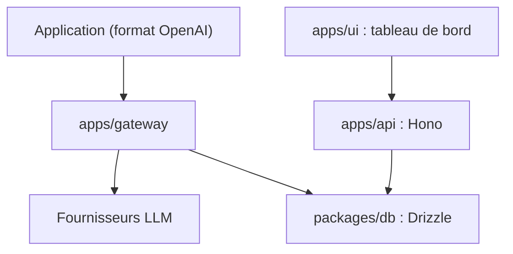

# theopenco/llmgateway

> An OpenAI-compatible LLM API gateway with multi-provider routing and cost tracking.

## The problem
Using several model providers scatters API keys, call formats and consumption tracking.

## What it actually does
An intermediary service in OpenAI format that routes requests to OpenAI, Anthropic, Google Vertex AI and others, centralizes keys and measures requests, tokens, response times and costs. It exists as a hosted version (llmgateway.io) or self-hosted. The monorepo contains the Next.js dashboard, the Hono API, the gateway, the Drizzle database, side apps and an "ee" part for enterprise.

## How it is wired


## Trying it
```bash
export LLM_GATEWAY_SECRET="$(openssl rand -base64 32 | tr -d '\n')"
export GATEWAY_API_KEY_HASH_SECRET="$(openssl rand -base64 32 | tr -d '\n')"
./scripts/run-unified-container.sh
```

## Cost and gotchas
Self-hosted: Docker, secrets to generate, named Docker volumes (no direct mount on the PostgreSQL folder), plus each provider's keys. The hosted version has an account and a key. Enterprise features (full request retention, billing, teams) fall under a separate license.

## What it is not
Not a model nor a quality evaluator. New provider integrations do not go through pull requests: they go through their Airside portal. The license is present but unidentified.

## Alternatives
No alternative cited in the README.

## For you
Worth watching: useful for centralizing keys and costs of several LLMs in a team, but the license is unclear and enterprise features are paid; check it before any serious use.
