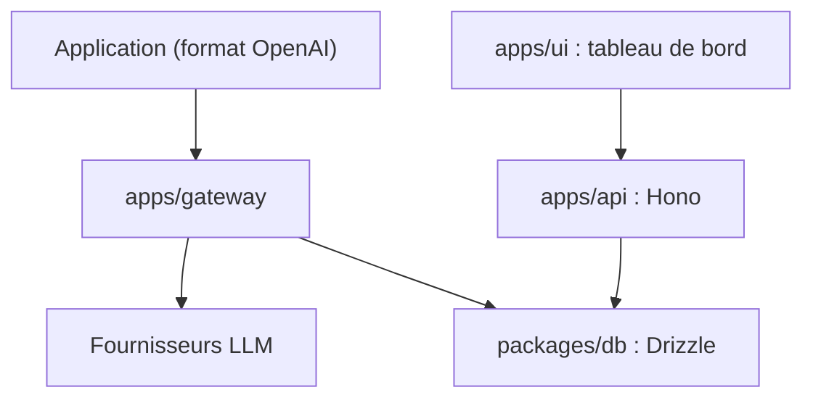

# theopenco/llmgateway

> Passerelle d'API pour LLM, compatible OpenAI, avec routage multi-fournisseurs et suivi des coûts.

## Le problème
Utiliser plusieurs fournisseurs de modèles disperse les clés d'API, les formats d'appel et le suivi de consommation.

## Ce que ça fait vraiment
Un service intermédiaire au format OpenAI qui route les requêtes vers OpenAI, Anthropic, Google Vertex AI et d'autres, centralise les clés et mesure requêtes, jetons, temps de réponse et coûts. Il existe en version hébergée (llmgateway.io) ou en auto-hébergement. Le monorepo contient le tableau de bord Next.js, l'API Hono, la passerelle, la base Drizzle, des apps annexes et une partie « ee » pour l'entreprise.

## Comment c'est branché


## Essayer
```bash
export LLM_GATEWAY_SECRET="$(openssl rand -base64 32 | tr -d '\n')"
export GATEWAY_API_KEY_HASH_SECRET="$(openssl rand -base64 32 | tr -d '\n')"
./scripts/run-unified-container.sh
```

## Coût et pièges
Auto-hébergé : Docker, secrets à générer, volumes Docker nommés (pas de montage direct sur le dossier de PostgreSQL), plus les clés de chaque fournisseur. La version hébergée a un compte et une clé. Les fonctions entreprise (conservation complète des requêtes, facturation, équipes) relèvent d'une licence séparée.

## Ce que ce n'est pas
Pas un modèle ni un évaluateur de qualité. Les nouvelles intégrations de fournisseurs ne passent pas par des pull requests : elles passent par leur portail Airside. La licence est présente mais non identifiée.

## Alternatives
Aucune alternative citée dans le README.

## Pour toi
À surveiller : utile pour centraliser clés et coûts de plusieurs LLM dans une équipe, mais licence floue et fonctions entreprise payantes ; vérifie-la avant tout usage sérieux.

