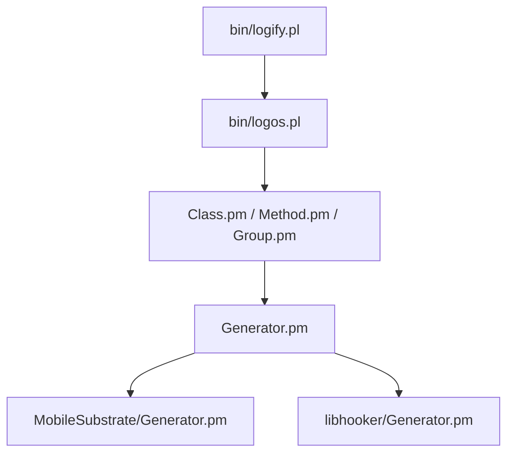

# theos/logos

> Perl preprocessor that simplifies writing Objective-C and C hooks, mainly for Theos.

## The problem
Writing Objective-C method hooks by hand (runtime, Substrate) is verbose and repetitive.

## What it actually does
logos.pl parses classes, methods and groups written with a `%hook` syntax, then a generator (MobileSubstrate or libhooker) produces the final Objective-C code. Intended for jailbreak tweaks.

## How it is wired


## Trying it
```bash
# Aucune commande d'installation dans le README ; exemple de source Tweak.x
# %hook NSObject ... %end  -> traité en Tweak.x.m
```

## Cost and gotchas
Free. Perl required (missing from the prerequisites list); used with Theos. License present but not identified.

## What it is not
Not a general-purpose tool: it targets the iOS jailbreak ecosystem. No link with data or AI.

## Alternatives
No alternative named in the README.

## For you
Ignore: iOS tweak tool, of no use to a data/AI/MLOps profile.
