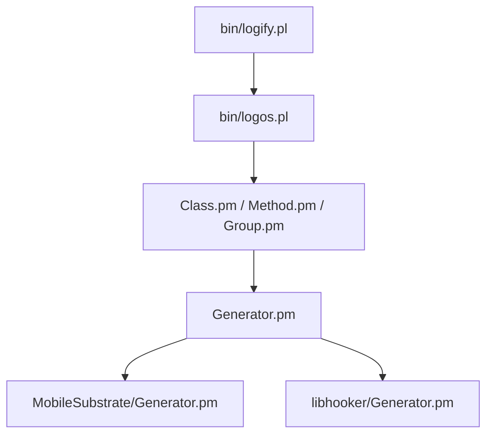

# theos/logos

> Préprocesseur Perl qui simplifie l'écriture de hooks Objective-C et C, surtout pour Theos.

## Le problème
Écrire à la main les hooks de méthodes Objective-C (runtime, Substrate) est verbeux et répétitif.

## Ce que ça fait vraiment
logos.pl analyse classes, méthodes et groupes écrits avec une syntaxe `%hook`, puis un générateur (MobileSubstrate ou libhooker) produit le code Objective-C final. Prévu pour les tweaks de jailbreak.

## Comment c'est branché


## Essayer
```bash
# Aucune commande d'installation dans le README ; exemple de source Tweak.x
# %hook NSObject ... %end  -> traité en Tweak.x.m
```

## Coût et pièges
Gratuit. Perl requis (absent de la liste des prérequis) ; s'utilise avec Theos. Licence présente mais non identifiée.

## Ce que ce n'est pas
Pas un outil généraliste : il vise l'écosystème jailbreak iOS. Pas de lien avec data ou IA.

## Alternatives
Aucune alternative nommée dans le README.

## Pour toi
À ignorer : outil de tweaks iOS, sans usage pour un profil data/IA/MLOps.

