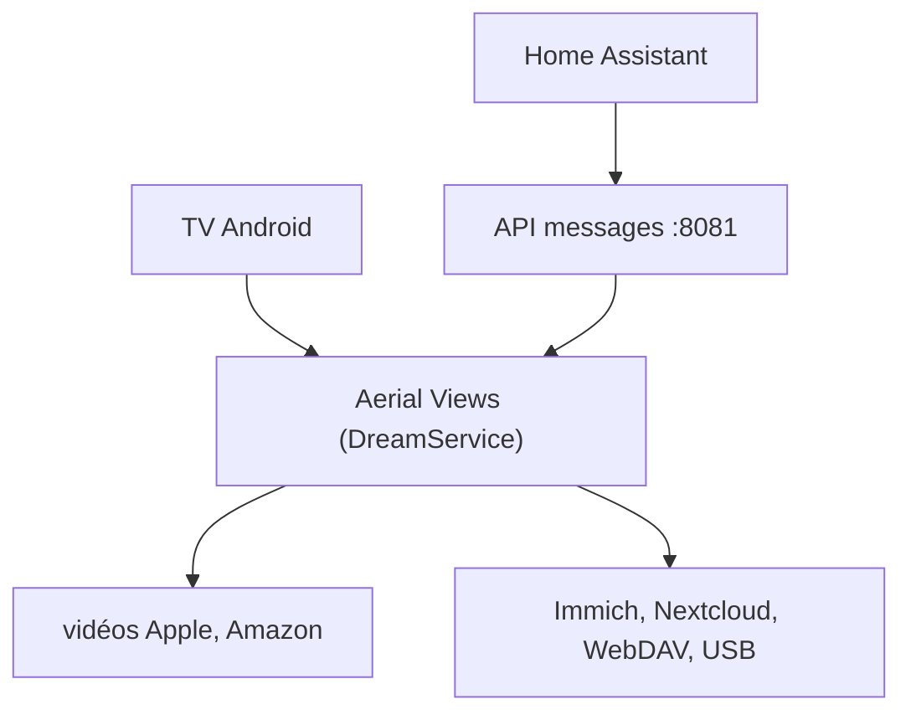

# theothernt/AerialViews

> Video screensaver for Android TV, Google TV and Fire TV, inspired by Apple TV.

## The problem
Recent Android TVs offer no menu to install a third-party screensaver.

## What it actually does
More than 250 videos (Apple, Amazon and others), in 4K Dolby Vision. It also plays your media from USB, Immich, Nextcloud, Samba or WebDAV. Overlays (clock, weather, music, messages), an HTTP messages API usable from Home Assistant, custom JSON or CSV feeds.

## How it is wired
Simplified diagram based on the sheet, no diagram provided.



## Trying it
```bash
adb connect <ip_address>
adb shell
settings put secure screensaver_components com.neilturner.aerialviews/.ui.screensaver.DreamActivity
```

## Cost and gotchas
Free. On recent Google TVs, activation goes through ADB (developer mode). Does not work with Fire OS 8.1 and later; the messages API opens a port on the local network.

## What it is not
Not a general media player. Does not replace the screensaver on devices without ADB settings.

## Alternatives
No alternative named in the README.

## For you
Ignore: home TV app, unrelated to data / AI / MLOps work.
