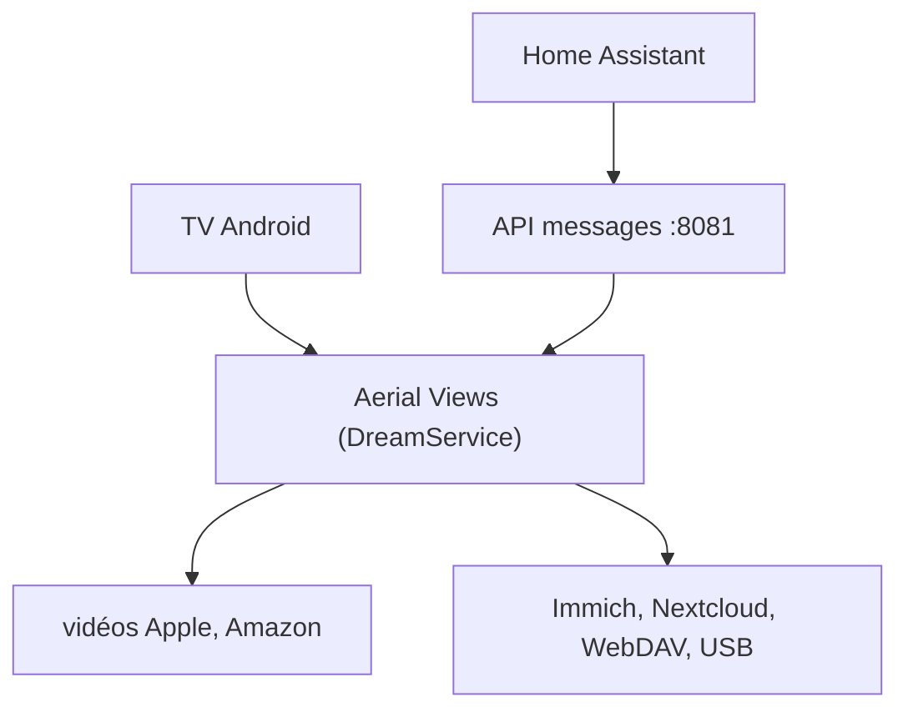

# theothernt/AerialViews

> Économiseur d'écran vidéo pour Android TV, Google TV et Fire TV, inspiré d'Apple TV.

## Le problème
Les TV Android récentes n'offrent pas de menu pour installer un économiseur d'écran tiers.

## Ce que ça fait vraiment
Plus de 250 vidéos (Apple, Amazon et autres), en 4K Dolby Vision. Il lit aussi vos médias depuis USB, Immich, Nextcloud, Samba ou WebDAV. Surcouches (horloge, météo, musique, messages), API HTTP de messages utilisable depuis Home Assistant, flux personnalisés JSON ou CSV.

## Comment c'est branché
Schéma simplifié d'après la fiche, sans diagramme fourni.



## Essayer
```bash
adb connect <ip_address>
adb shell
settings put secure screensaver_components com.neilturner.aerialviews/.ui.screensaver.DreamActivity
```

## Coût et pièges
Gratuit. Sur Google TV récentes, l'activation passe par ADB (mode développeur). Ne marche pas avec Fire OS 8.1 et plus ; l'API de messages ouvre un port sur le réseau local.

## Ce que ce n'est pas
Pas un lecteur multimédia général. Ne remplace pas l'économiseur sur les appareils sans réglage ADB.

## Alternatives
Aucune alternative nommée dans le README.

## Pour toi
Ignorer : app pour TV domestique, sans lien avec un travail data / IA / MLOps.

