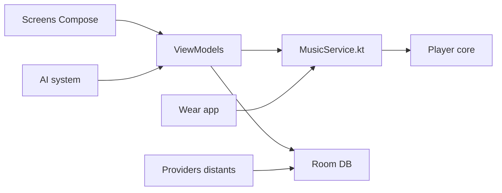

# theovilardo/PixelPlayer

> An Android music player in Jetpack Compose, with Material You, synchronized lyrics and AI playlists.

## The problem
Local Android players lack visual polish and discovery features.

## What it actually does
Local playback (Media3 ExoPlayer, gapless, fades), library by albums/artists/genres, LRC lyrics (LRCLIB), artist images (Deezer), Chromecast, widgets, tag editor. Remote sources: Jellyfin, Navidrome, GDrive, Netease, QQ, Telegram. A Wear OS companion. AI playlists via Gemini, OpenAI, DeepSeek, Groq or Mistral.

## How it is wired


## Trying it
```bash
git clone https://github.com/theovilardo/PixelPlayer.git
# puis ouvrir dans Android Studio, synchroniser Gradle, lancer
```
The Download section of the README is empty in the supplied text.

## Cost and gotchas
Free. Android 11+, 6 GB of RAM recommended. AI playlists require your own provider key. Android Studio, SDK, JDK 11+ to build.

## What it is not
Not a data/AI project: the AI part is just an API call for playlists. No support for forks, and a license is present but not identified.

## Alternatives
No alternative named in the README.

## For you
Ignore: consumer application outside your data/MLOps scope, with a license to clarify and 662 open issues.
