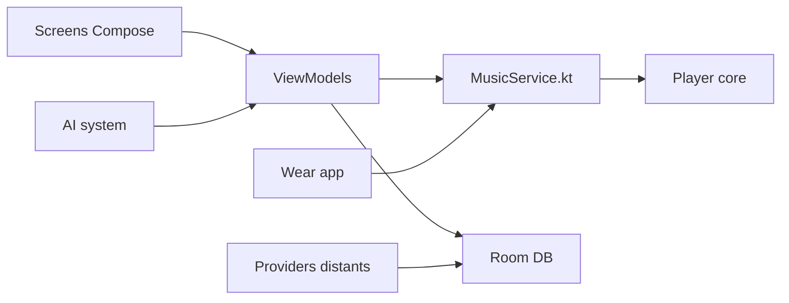

# theovilardo/PixelPlayer

> Un lecteur de musique Android en Jetpack Compose, avec Material You, paroles synchronisées et playlists par IA.

## Le problème
Les lecteurs locaux Android manquent de finition visuelle et de fonctions de découverte.

## Ce que ça fait vraiment
Lecture locale (Media3 ExoPlayer, gapless, fondus), bibliothèque par albums/artistes/genres, paroles LRC (LRCLIB), images d'artistes (Deezer), Chromecast, widgets, éditeur de tags. Sources distantes : Jellyfin, Navidrome, GDrive, Netease, QQ, Telegram. Une compagnon Wear OS. Playlists IA via Gemini, OpenAI, DeepSeek, Groq ou Mistral.

## Comment c'est branché


## Essayer
```bash
git clone https://github.com/theovilardo/PixelPlayer.git
# puis ouvrir dans Android Studio, synchroniser Gradle, lancer
```
La section Download du README est vide dans le texte fourni.

## Coût et pièges
Gratuit. Android 11+, 6 Go de RAM conseillés. Les playlists IA exigent ta propre clé fournisseur. Android Studio, SDK, JDK 11+ pour compiler.

## Ce que ce n'est pas
Pas un projet data/IA : la partie IA n'est qu'un appel d'API pour des playlists. Aucun support pour les forks, et licence présente mais non identifiée.

## Alternatives
Aucune alternative nommée dans le README.

## Pour toi
Ignorer : application grand public hors de ton périmètre data/MLOps, avec une licence à clarifier et 662 issues ouvertes.

