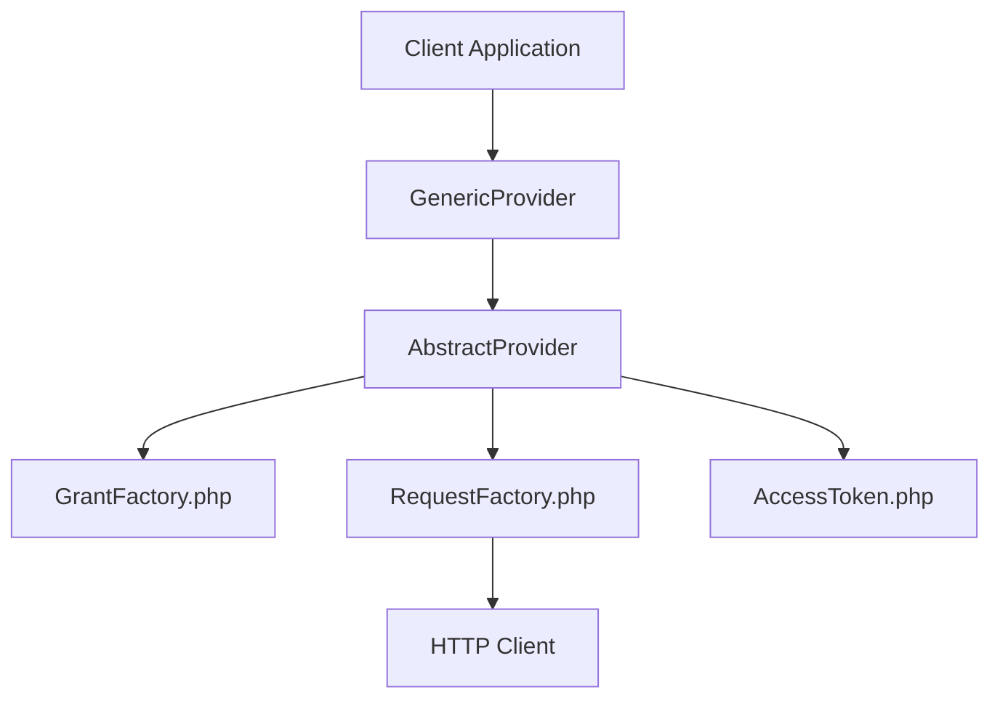

# thephpleague/oauth2-client

> Base PHP library for connecting to an OAuth 2.0 provider ("Sign in with...").

## The problem
Correctly implementing the OAuth 2.0 flow of RFC 6749 is time-consuming and easy to get wrong.

## What it actually does
An abstract provider orchestrates building the authorization URL, exchanging the code for a token, refreshing, and authenticated calls. Grant types (authorization code, client credentials, password, refresh token) go through a factory. A `GenericProvider` covers any Bearer-token provider; dedicated clients exist for Facebook, GitHub, Google, etc.

## How it is wired


## Trying it
```bash
# Aucune commande dans le README : l'usage est décrit dans le guide d'utilisation lié.
```

## Cost and gotchas
Free, MIT. PHP 7.1 to 8.5 supported. The specific providers (Google, GitHub...) are separate packages, official or third-party.

## What it is not
Not an authorization server or a session system. It does not provide the login interface.

## Alternatives
No alternative named in the README.

## For you
Ignore: a PHP authentication library, outside the data, AI or MLOps scope.
