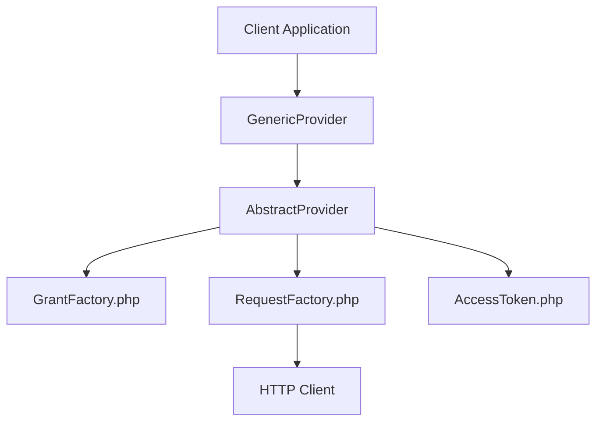

# thephpleague/oauth2-client

> Bibliothèque PHP de base pour se connecter à un fournisseur OAuth 2.0 (« Se connecter avec... »).

## Le problème
Implémenter correctement le flux OAuth 2.0 de la RFC 6749 est long et facile à rater.

## Ce que ça fait vraiment
Un fournisseur abstrait orchestre la construction de l'URL d'autorisation, l'échange du code contre un jeton, le rafraîchissement et les appels authentifiés. Les types de grants (code d'autorisation, identifiants client, mot de passe, refresh token) passent par une fabrique. Un `GenericProvider` couvre tout fournisseur à jeton Bearer ; des clients dédiés existent pour Facebook, GitHub, Google, etc.

## Comment c'est branché


## Essayer
```bash
# Aucune commande dans le README : l'usage est décrit dans le guide d'utilisation lié.
```

## Coût et pièges
Gratuit, MIT. PHP 7.1 à 8.5 pris en charge. Les fournisseurs précis (Google, GitHub...) sont des paquets séparés, officiels ou tiers.

## Ce que ce n'est pas
Pas un serveur d'autorisation ni un système de sessions. Il ne fournit pas l'interface de connexion.

## Alternatives
Aucune alternative nommée dans le README.

## Pour toi
À ignorer : bibliothèque PHP d'authentification, hors du périmètre data, IA ou MLOps.

