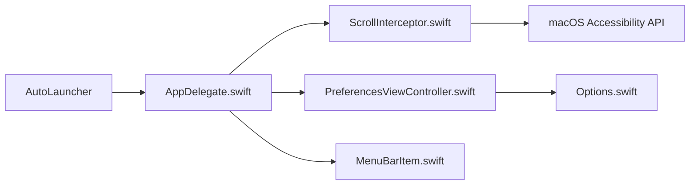

# ther0n/UnnaturalScrollWheels

> macOS utility that reverses mouse wheel scrolling without touching the trackpad.

## The problem
On macOS, the "natural scrolling" option is shared between mouse and trackpad: reversing one reverses the other.

## What it actually does
A menu bar application that intercepts scroll events via the macOS accessibility API, reverses those of the wheel and can disable mouse acceleration. An `AutoLauncher` executable starts the application at login. Preferences reopen by relaunching the app if the icon is hidden.

## How it is wired


## Trying it
```bash
brew install --cask unnaturalscrollwheels
```

## Cost and gotchas
Free. Requests the "Control the computer" accessibility permission, needed to intercept and modify events. GPL-3.0 license.

## What it is not
Not a development or data productivity tool: a comfort fix for macOS only.

## Alternatives
No alternative named in the README (an Apple StackExchange discussion describes the problem).

## For you
Ignore: macOS comfort utility unrelated to data or AI, only useful if you use a wheel mouse on a Mac.
