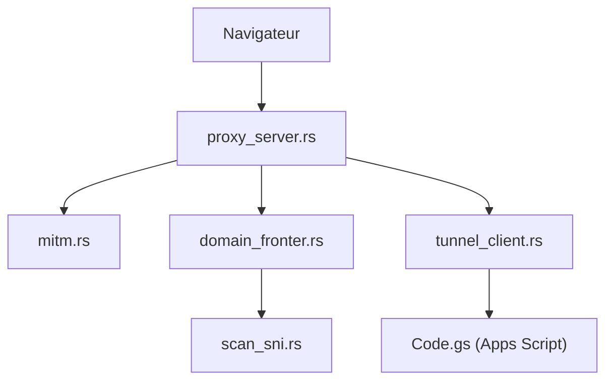

# therealaleph/MasterHttpRelayVPN-RUST

> Rust client that bypasses censorship by relaying traffic through a Google Apps Script deployed in your account.

## The problem
An internet provider blocks certain sites by SNI or packet inspection.

## What it actually does
- Local HTTP and SOCKS5 proxy on `127.0.0.1:8085`.
- Traffic goes to Google, which relays it via your Apps Script.
- Generates a local certificate authority to decrypt HTTPS.
- CLI binary, desktop interface, Android app and optional tunnel node.

## How it is wired


## Trying it
```bash
./run.sh
```
The README also describes: create the script, download the release, run `run.command`, `run.bat` or `./run.sh`, then set the browser proxy to `127.0.0.1:8085`.

## Cost and gotchas
Free with a Google account (quota of 20,000 requests per day). Installs a local root certificate. Google sees the sites visited; YouTube video and Telegram are unstable.

## What it is not
Not a private VPN: Google reads the relayed traffic. The Rust code was largely written with Claude, reviewed by a human at each commit.

## Alternatives
No alternative named in the README (the original Python project MasterHttpRelayVPN is cited).

## For you
Ignore: a censorship-bypass tool dependent on Google, with a root certificate to install, outside your data / AI scope.
