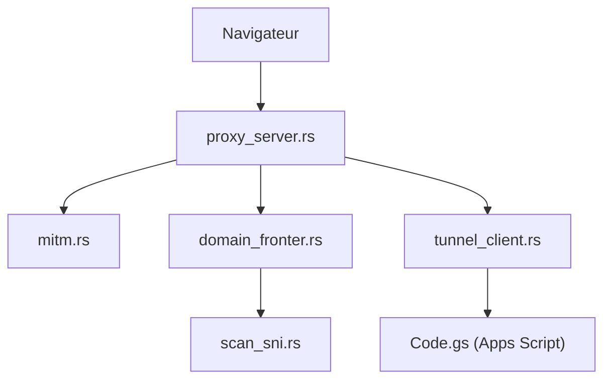

# therealaleph/MasterHttpRelayVPN-RUST

> Client Rust qui contourne la censure en relayant le trafic via un Google Apps Script déployé dans ton compte.

## Le problème
Un fournisseur d'accès bloque certains sites par SNI ou inspection de paquets.

## Ce que ça fait vraiment
- Proxy local HTTP et SOCKS5 sur `127.0.0.1:8085`.
- Le trafic part vers Google, qui relaie via ton script Apps Script.
- Génère une autorité de certification locale pour déchiffrer le HTTPS.
- Binaire CLI, interface de bureau, application Android et nœud de tunnel optionnel.

## Comment c'est branché


## Essayer
```bash
./run.sh
```
Le README décrit aussi : créer le script, télécharger la version, lancer `run.command`, `run.bat` ou `./run.sh`, puis régler le proxy du navigateur sur `127.0.0.1:8085`.

## Coût et pièges
Gratuit avec un compte Google (quota de 20 000 requêtes par jour). Installe un certificat racine local. Google voit les sites visités ; YouTube vidéo et Telegram sont instables.

## Ce que ce n'est pas
Pas un VPN privé : Google lit le trafic relayé. Le code Rust a été écrit en grande partie avec Claude, relu par un humain à chaque commit.

## Alternatives
Aucune alternative nommée dans le README (le projet original MasterHttpRelayVPN en Python est cité).

## Pour toi
À ignorer : outil de contournement de censure dépendant de Google, avec certificat racine à installer, hors de ton périmètre data / IA.

