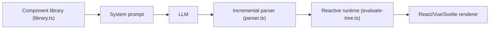

# thesysdev/openui

> LLM-driven interface generation framework, with a compact streaming language and React, Vue, Svelte and Angular renderers.

## The problem
An LLM that answers in JSON to describe an interface is expensive in tokens and renders poorly while streaming.

## What it actually does
OpenUI Lang describes the interface in a compact format. You define a component library (Zod contracts), the framework derives the system prompt from it, the model streams the language, an incremental parser validates it, then a renderer displays it live. The README claims up to 67% fewer tokens than JSON (in-house benchmarks). Packages cover headless chat, LangChain, email, CLI and observability.

## How it is wired


## Trying it
```bash
npx @openuidev/cli@latest create --name genui-chat-app
npm install @openuidev/react-lang @openuidev/react-ui
npm install @openuidev/lang-core
```

## Cost and gotchas
Free, but the model you call is at your expense (API key). A cloud option and sending of observability events to Thesys exist; the CLI also offers anonymous feedback submission.

## What it is not
Not a design tool: the model generates the interface within the limits of your library. The token figures come from the authors.

## Alternatives
- json-render (Vercel): JSON format, more tokens.
- A2UI (Google): protocol, custom components only.
- CopilotKit OpenGenUI: no component library.

## For you
Worth watching: interesting for copilots with generative UI, but young and tied to the Thesys ecosystem.
