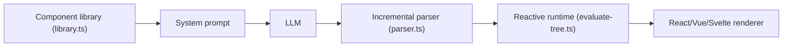

# thesysdev/openui

> Framework de génération d'interfaces par LLM, avec un langage compact en streaming et des moteurs de rendu React, Vue, Svelte, Angular.

## Le problème
Un LLM qui répond en JSON pour décrire une interface coûte cher en tokens et se rend mal pendant le streaming.

## Ce que ça fait vraiment
OpenUI Lang décrit l'interface dans un format compact. Tu définis une bibliothèque de composants (contrats Zod), le framework en tire le prompt système, le modèle streame le langage, un parseur incrémental le valide, puis un moteur de rendu l'affiche en direct. Le README annonce jusqu'à 67 % de tokens en moins que JSON (benchmarks maison). Des paquets couvrent chat headless, LangChain, e-mail, CLI et observabilité.

## Comment c'est branché


## Essayer
```bash
npx @openuidev/cli@latest create --name genui-chat-app
npm install @openuidev/react-lang @openuidev/react-ui
npm install @openuidev/lang-core
```

## Coût et pièges
Gratuit, mais le modèle appelé est à ta charge (clé d'API). Une option de cloud et un envoi d'événements d'observabilité vers Thesys existent ; le CLI propose aussi un envoi de retours anonyme.

## Ce que ce n'est pas
Pas un outil de design : le modèle génère l'interface dans les limites de ta bibliothèque. Les chiffres de tokens viennent des auteurs.

## Alternatives
- json-render (Vercel) : format JSON, plus de tokens.
- A2UI (Google) : protocole, composants personnalisés seulement.
- CopilotKit OpenGenUI : sans bibliothèque de composants.

## Pour toi
À surveiller : intéressant pour des copilotes avec UI générative, mais jeune et lié à l'écosystème Thesys.

