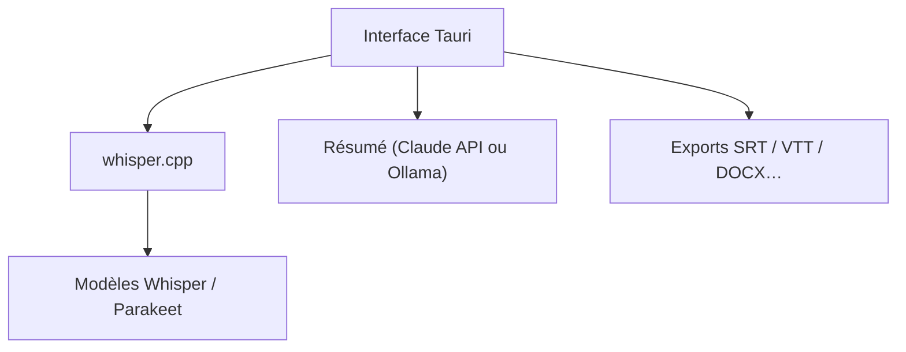

# thewh1teagle/vibe

> Fully local desktop application for audio and video transcription, based on Whisper.

## The problem
Transcribing recordings without sending your data to a cloud service and without writing scripts.

## What it actually does
Transcribes audio and video offline in almost every language, with Whisper, Nemotron 3.5 and Parakeet TDT v3. GPU acceleration (Vulkan, CoreML). Exports to SRT, VTT, TXT, HTML, PDF, JSON, DOCX. Offers diarization, batch processing, microphone, system audio, a CLI and an HTTP API. Optional summaries via Claude or Ollama.

## How it is wired

Simplified diagram based on the README's acknowledgements (Tauri, whisper.cpp).

## Trying it
No command documented in the README: download the application from the "Download Vibe" link; CLI help is available via `--help`.

## Cost and gotchas
Free locally. Summaries with Claude require an API key at your own expense. The GPU speeds things up but the README does not say whether it is mandatory. Pull requests are limited to a few collaborators.

## What it is not
Not a cloud service. The "stable timestamps" mode is slower. Some summary options go beyond purely offline mode.

## Alternatives
No alternative named in the README.

## For you
Adopt: clean local transcription for meetings and audio corpora, with an API and CLI to plug into a pipeline, with no data leakage.
