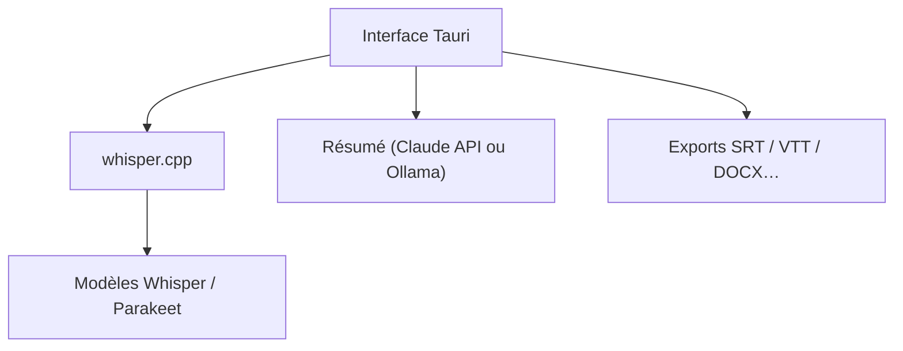

# thewh1teagle/vibe

> Application de bureau de transcription audio et vidéo, entièrement locale, basée sur Whisper.

## Le problème
Transcrire des enregistrements sans envoyer ses données à un service cloud et sans écrire de scripts.

## Ce que ça fait vraiment
Transcrit audio et vidéo hors ligne dans presque toutes les langues, avec Whisper, Nemotron 3.5 et Parakeet TDT v3. Accélération GPU (Vulkan, CoreML). Exporte en SRT, VTT, TXT, HTML, PDF, JSON, DOCX. Propose diarisation, traitement par lot, micro, audio système, CLI et API HTTP. Résumés optionnels via Claude ou Ollama.

## Comment c'est branché

Schéma simplifié d'après les remerciements du README (Tauri, whisper.cpp).

## Essayer
Aucune commande documentée dans le README : télécharger l'application depuis le lien « Download Vibe » ; l'aide de la CLI est disponible via `--help`.

## Coût et pièges
Gratuit en local. Les résumés avec Claude exigent une clé d'API à ta charge. Le GPU accélère mais le README ne dit pas s'il est obligatoire. Les pull requests sont limitées à quelques collaborateurs.

## Ce que ce n'est pas
Pas un service cloud. Le mode « timestamps stables » est plus lent. Certaines options de résumé sortent du mode purement hors ligne.

## Alternatives
Aucune alternative nommée dans le README.

## Pour toi
À adopter : transcription locale propre pour réunions et corpus audio, avec API et CLI pour s'intégrer à un pipeline, sans fuite de données.

