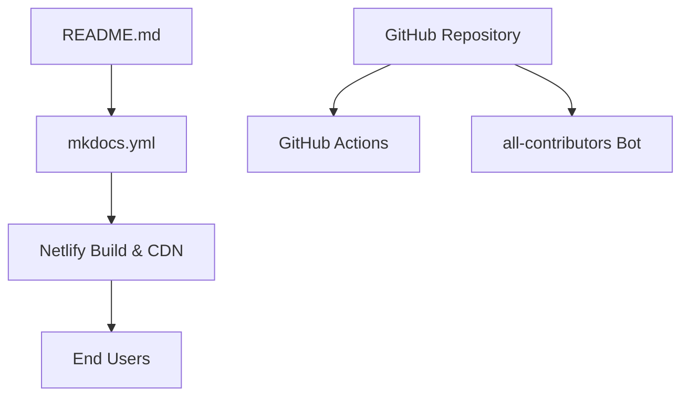

# thibmaek/awesome-raspberry-pi

> Annotated list of models, systems, tools and projects around the Raspberry Pi.

## The problem
Raspberry Pi resources are scattered: systems, imaging tools and projects are hard to find.

## What it actually does
Organized in five parts: models (Pi 1 to Pi 5, Pico, 500), system images (Raspberry Pi OS, DietPi, RetroPie, OpenWRT...), tools (balenaEtcher, PiShrink, Pi Imager...), projects and resources. The content is served by MkDocs and Netlify according to the architecture.

## How it is wired
Diagram based on the code diagram, simplified.

## Trying it
No command: it is a list of resources. Open the repository README and browse the categories (systems, tools, projects) to find what you need.

## Cost and gotchas
Free. The README is truncated to the excerpt provided: the Resources sections were not read. The license is not recognized by GitHub. Entries are not verified one by one; the list includes USB and Wi-Fi attack projects (P4wnP1, PoisonTap, Pwnagotchi), as list entries only.

## What it is not
Not a tool to install. Not a learning guide. No guarantee on the quality or maintenance of the listed projects.

## Alternatives
None named in the README.

## For you
Keep an eye on it: source of ideas for embedded AI on Pi (EdgeLLM Bench, LocalKin), to consult occasionally.
