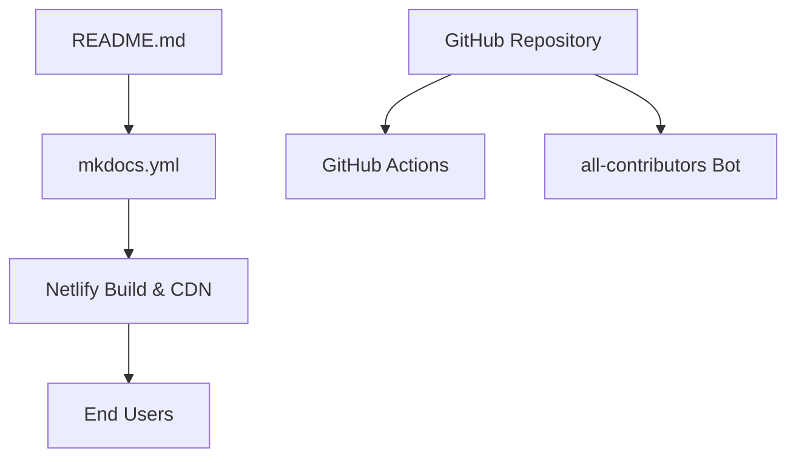

# thibmaek/awesome-raspberry-pi

> Liste commentée de modèles, systèmes, outils et projets autour du Raspberry Pi.

## Le problème
Les ressources Raspberry Pi sont dispersées : systèmes, outils d'image et projets sont difficiles à trouver.

## Ce que ça fait vraiment
Classe en cinq parties : modèles (Pi 1 à Pi 5, Pico, 500), images de systèmes (Raspberry Pi OS, DietPi, RetroPie, OpenWRT...), outils (balenaEtcher, PiShrink, Pi Imager...), projets et ressources. Le contenu est servi par MkDocs et Netlify d'après l'architecture.

## Comment c'est branché
Schéma d'après le diagramme du code, simplifié.

## Essayer
Aucune commande : liste à parcourir.

## Coût et pièges
Gratuit. Le README est tronqué à l'extrait fourni : les sections Ressources ne sont pas lues. La licence n'est pas reconnue par GitHub. Les entrées ne sont pas vérifiées une à une ; la liste inclut des projets d'attaque USB et Wi-Fi (P4wnP1, PoisonTap, Pwnagotchi), comme entrées de la liste seulement.

## Ce que ce n'est pas
Pas un outil à installer. Pas un guide d'apprentissage. Pas de garantie sur la qualité ou la maintenance des projets listés.

## Alternatives
Aucune nommée dans le README.

## Pour toi
À surveiller : source d'idées pour de l'IA embarquée sur Pi (EdgeLLM Bench, LocalKin), à consulter ponctuellement.

