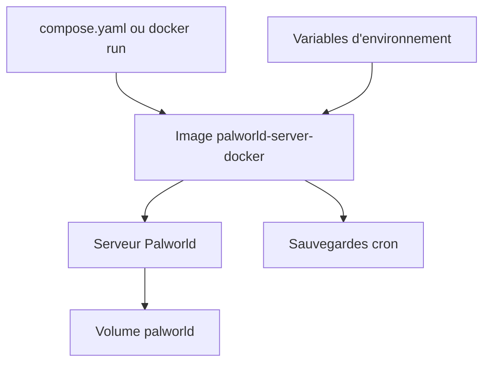

# thijsvanloef/palworld-server-docker

> Docker image for hosting a Palworld dedicated server, for players who run their own server.

## The problem
Installing and maintaining a Palworld dedicated server by hand (SteamCMD, updates, backups) is tedious.

## What it actually does
A Linux image (amd64, arm64) and a Wine variant for Windows. Configuration goes through environment variables: players, ports, passwords, REST API, automatic cron backups, updates at startup, mods. Kubernetes files and a separate Helm chart are provided.

## How it is wired
Simplified diagram based on the sheet, no diagram provided.


## Trying it
```bash
docker run -d --name palworld-server -p 8211:8211/udp -p 27015:27015/udp -v ./palworld:/palworld/ -e PUID=1000 -e PGID=1000 -e PORT=8211 -e PLAYERS=16 --restart unless-stopped --stop-timeout 30 thijsvanloef/palworld-server-docker:latest
```

## Cost and gotchas
Free, MIT. Stated minimum: 4 cores, 16 GB of RAM, 8 GB of disk. The REST port 8212 must not be exposed. DEBUG mode writes secrets to the logs.

## What it is not
Not a data or AI tool. Not an administration panel. The end of the README (variables, backups) is truncated here.

## Alternatives
No alternative named in the README, apart from the official Helm chart in a separate repository.

## For you
Ignore: a game server has no link with your data, AI or MLOps work.
