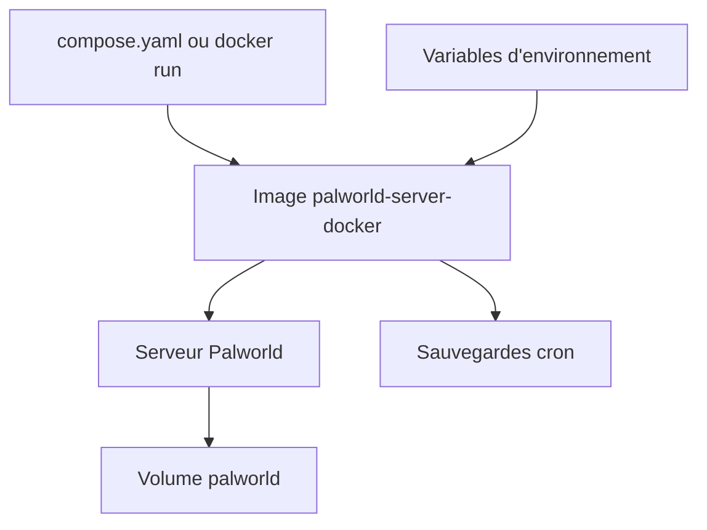

# thijsvanloef/palworld-server-docker

> Image Docker pour héberger un serveur dédié Palworld, pour les joueurs qui gèrent leur propre serveur.

## Le problème
Installer et maintenir un serveur dédié Palworld à la main (SteamCMD, mises à jour, sauvegardes) est fastidieux.

## Ce que ça fait vraiment
Une image Linux (amd64, arm64) et une variante Wine pour Windows. La configuration passe par des variables d'environnement : joueurs, ports, mots de passe, API REST, sauvegardes automatiques par cron, mises à jour au démarrage, mods. Des fichiers Kubernetes et un chart Helm séparé sont fournis.

## Comment c'est branché
Schéma simplifié d'après la fiche, sans diagramme fourni.


## Essayer
```bash
docker run -d --name palworld-server -p 8211:8211/udp -p 27015:27015/udp -v ./palworld:/palworld/ -e PUID=1000 -e PGID=1000 -e PORT=8211 -e PLAYERS=16 --restart unless-stopped --stop-timeout 30 thijsvanloef/palworld-server-docker:latest
```

## Coût et pièges
Gratuit, MIT. Minimum annoncé : 4 cœurs, 16 Go de RAM, 8 Go de disque. Le port REST 8212 ne doit pas être exposé. Le mode DEBUG écrit les secrets dans les journaux.

## Ce que ce n'est pas
Pas un outil data ni IA. Pas un panneau d'administration. La fin du README (variables, sauvegardes) est tronquée ici.

## Alternatives
Aucune alternative nommée dans le README, hors le chart Helm officiel dans un dépôt séparé.

## Pour toi
À ignorer : un serveur de jeu n'a aucun lien avec ton métier data, IA ou MLOps.

