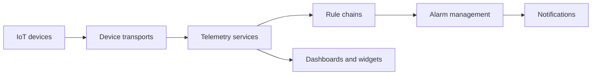

# thingsboard/thingsboard

> Complete IoT platform to collect, process and visualize device data.

## The problem
Connecting sensors, storing their telemetry, triggering alarms and building dashboards takes many building blocks.

## What it actually does
Device and asset management, transports (collection), rule chains (Rule Engine) and calculated fields, alarms, notifications (email, SMS, mobile), real-time dashboards and SCADA. The README stays very marketing-heavy; the architecture confirms it by domain.

## How it is wired

## Trying it
No command in the README: it points to the "Getting started" guide, a local installation or ThingsBoard Cloud.

## Cost and gotchas
Local installation or cloud offering; pricing not documented. A license is present but not identified by GitHub: read it before any commercial use.

## What it is not
Not a data/ML platform: it is IoT. No machine learning is announced in the README.

## Alternatives
None named in the README.

## For you
Ignore: IoT/SCADA, only worth a look if you handle industrial telemetry.
