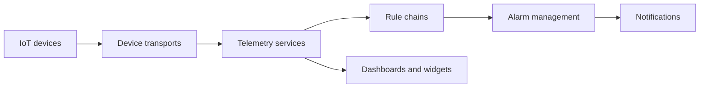

# thingsboard/thingsboard

> Plateforme IoT complète pour collecter, traiter et visualiser les données d'appareils.

## Le problème
Connecter des capteurs, stocker leur télémétrie, déclencher des alarmes et construire des tableaux de bord demande beaucoup de briques.

## Ce que ça fait vraiment
Gestion des appareils et actifs, transports (collecte), chaînes de règles (Rule Engine) et champs calculés, alarmes, notifications (email, SMS, mobile), tableaux de bord temps réel et SCADA. Le README reste très marketing ; l'architecture le confirme par domaines.

## Comment c'est branché

## Essayer
Aucune commande dans le README : il renvoie au guide « Getting started », à une installation locale ou à ThingsBoard Cloud.

## Coût et pièges
Installation locale ou offre cloud ; tarifs non documentés. Licence présente mais non identifiée par GitHub : à lire avant tout usage commercial.

## Ce que ce n'est pas
Pas une plateforme data/ML : de l'IoT. Aucun apprentissage automatique annoncé dans le README.

## Alternatives
Aucune nommée dans le README.

## Pour toi
Ignorer : de l'IoT/SCADA, à ne regarder que si tu traites de la télémétrie industrielle.

