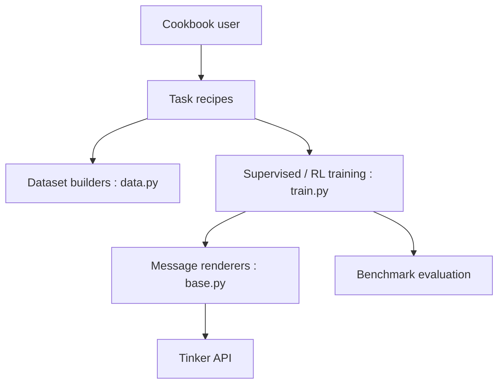

# thinking-machines-lab/tinker-cookbook

> Recipes and abstractions for fine-tuning language models through the Tinker training API, for researchers and engineers.

## The problem
Setting up distributed SFT, RL or DPO takes a lot of infrastructure.

## What it actually does
The `tinker` SDK sends requests to a service that handles distributed training (LoRA). This repository provides recipes: chat SFT, RL for math and code, preferences (DPO, RLHF), distillation, tools, multi-agents, audio, VLM. It also contains renderers, hyperparameter utilities and an experimental evaluation framework (12 benchmarks). Claude Code skills are provided.

## How it is wired


## Trying it
```bash
export TINKER_API_KEY=...
uv pip install tinker-cookbook
marimo edit tutorials/101_hello_tinker.py
```

## Cost and gotchas
Signing up on Tinker and an API key are required; training runs on their side and is paid (see the cited "Models & Pricing"). Torch 2.10 or later.

## What it is not
Not local training: without access to the service, the recipes do not run. Benchmark scores depend heavily on the configuration, the README warns.

## Alternatives
No alternative named in the README.

## For you
Worth watching: very instructive post-training recipes to read, but execution depends on a paid third-party service.
