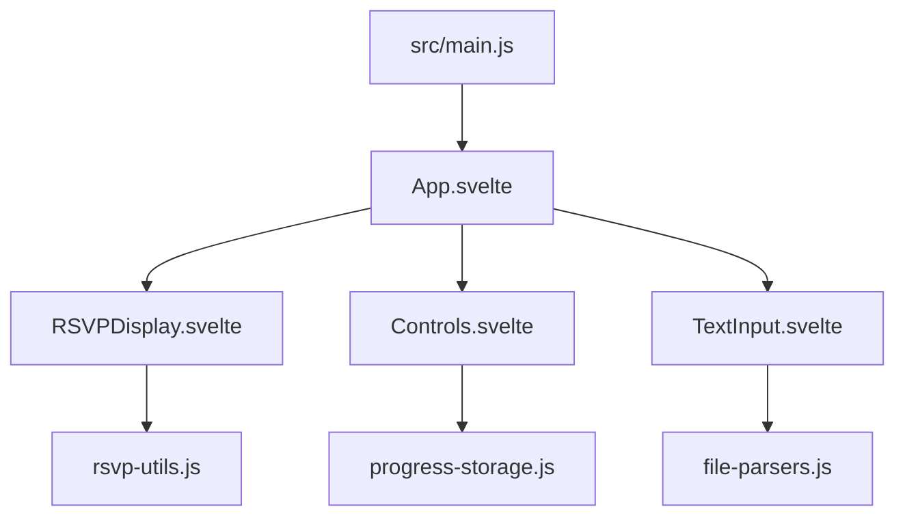

# thomaskolmans/rsvp-reading

> Svelte speed-reading viewer, one word at a time, with PDF and EPUB import.

## The problem
Reading fast without eye movement requires a tool that shows words one by one at a fixed point.

## What it actually does
The app displays one word at a time with the focal letter in red, from 50 to 1000 words per minute. It extracts text from PDF and EPUB, saves the session in the browser and offers pauses, position jumping and keyboard shortcuts. A live demo is linked.

## How it is wired


## Trying it
```bash
git clone https://github.com/yourusername/rsvp.git
cd rsvp
npm install
npm run dev
cd docker && docker compose up -d
```

## Cost and gotchas
Free. Node for development, or Docker Compose (port 8080). The clone address in the README is a template (`yourusername`), to be corrected.

## What it is not
It is not proven that reading one word at a time improves comprehension: the README says "potentially". It is not a data tool.

## Alternatives
No alternative named in the README.

## For you
Ignore for your work; a personal reading curiosity, with no data / AI relevance.
