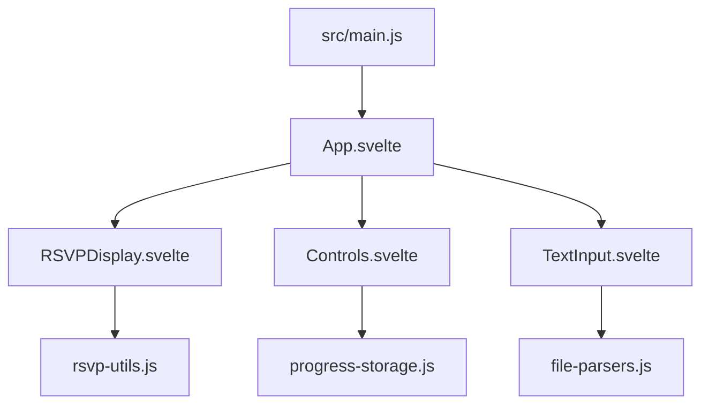

# thomaskolmans/rsvp-reading

> Lecteur Svelte de lecture rapide, un mot à la fois, avec import de PDF et d'EPUB.

## Le problème
Lire vite sans mouvements des yeux demande un outil qui affiche les mots un par un à un point fixe.

## Ce que ça fait vraiment
L'app affiche un mot à la fois avec la lettre focale en rouge, de 50 à 1000 mots par minute. Elle extrait le texte de PDF et d'EPUB, sauvegarde la session dans le navigateur et propose pauses, saut de position et raccourcis clavier. Une démo en ligne est liée.

## Comment c'est branché


## Essayer
```bash
git clone https://github.com/yourusername/rsvp.git
cd rsvp
npm install
npm run dev
cd docker && docker compose up -d
```

## Coût et pièges
Gratuit. Node pour le développement, ou Docker Compose (port 8080). L'adresse de clonage du README est un modèle (`yourusername`), à corriger.

## Ce que ce n'est pas
Ce n'est pas prouvé que la lecture un mot à la fois améliore la compréhension : le README dit « potentiellement ». Ce n'est pas un outil de données.

## Alternatives
Aucune alternative nommée dans le README.

## Pour toi
À ignorer pour ton travail ; curiosité personnelle de lecture, sans portée data / IA.

