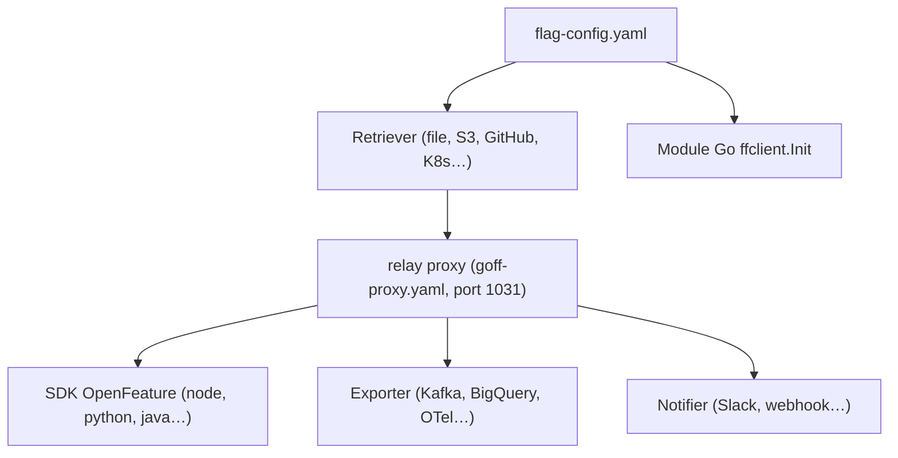

# thomaspoignant/go-feature-flag

> Full-featured feature flags driven by a simple configuration file, with no backend to maintain.

## The problem
Feature flag solutions force a third-party service and a bill, whereas the need
often fits in a versioned YAML file.

## What it actually does
Centralizes all flags in a YAML, JSON or TOML file, retrieved from about fifteen
sources (GitHub, GitLab, HTTP, S3, local file, Google Cloud Storage, Kubernetes
ConfigMaps, MongoDB, Redis, BitBucket, Azure Blob, PostgreSQL). Two usage modes: a Go
module that evaluates directly in code, or a hosted **relay proxy** that exposes an API and makes the
solution multi-language through the OpenFeature SDKs (Go, Java/Kotlin, server and client JS/TS,
Python, .NET, Ruby, Swift, PHP, Rust via OFREP). Targeting rules in a simple expression language
(`eq`, `co`, `sw`, `in`, `pr`…) or in JSONLogic, format auto-detected. Percentage, progressive and
scheduled rollouts, or time-boxed experimentation. Evaluation export to S3, Kinesis, SQS, GCS, PubSub, Kafka, BigQuery, Azure Blob, webhook,
OpenTelemetry. Notifications to Slack, Discord, Teams, webhook, log.

## How it is wired


## Trying it
```bash
docker run \
  -p 1031:1031 \
  -v $(pwd)/flag-config.yaml:/goff/flag-config.yaml \
  -v $(pwd)/goff-proxy.yaml:/goff/goff-proxy.yaml \
  gofeatureflag/go-feature-flag:latest
go get github.com/thomaspoignant/go-feature-flag
npm i @openfeature/server-sdk @openfeature/go-feature-flag-provider
```

## Cost and gotchas
Free, no third-party service required. The README recommends the relay proxy over the Go
module as soon as there is more than one language. A unique targeting key (`targetingKey`) is
mandatory on every evaluation, and using a hash rather than an email is advised.
Locally the file is enough; in production you need remote storage.

## What it is not
It is not a platform with a hosted admin interface — a web editor exists
(editor.gofeatureflag.org) but the source of truth remains the file. It is no longer a Go
library only. And the export currently covers only "feature events".

## Alternatives
- OpenFeature, the standard it builds on: switching provider does not break the code.
- `go-feature-flag-cli`, the configuration lint tool, complementary.

## For you
The sober choice for driving model or pipeline variants without taking on a SaaS.
