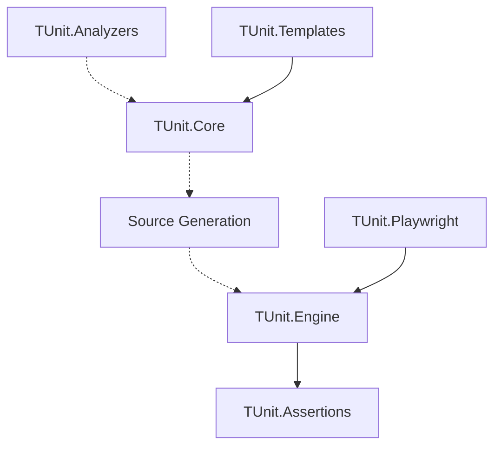

# thomhurst/TUnit

> .NET test framework with source-generator discovery, for C#, F# and VB developers.

## The problem
Classic .NET test frameworks discover tests through reflection at runtime, which slows startup and gets in the way of Native AOT.

## What it actually does
A source generator registers the tests at compile time. Tests run in parallel by default, with `[DependsOn]`, `[NotInParallel]` and `[ParallelLimiter]` to control ordering. It provides asynchronous assertions, shared fixtures with injection, lifecycle hooks and a generated mocking library. Roslyn analyzers make the build fail on usage errors.

## How it is wired


## Trying it
```bash
dotnet new install TUnit.Templates
dotnet new TUnit -n "MyTestProject"
cd MyTestProject
dotnet run
# ou, dans un projet existant :
dotnet add package TUnit
```

## Cost and gotchas
Free, MIT license. A .NET SDK is required; the README's measurements run on .NET 10. Tests use TUnit-specific attributes: migrating from xUnit, NUnit or MSTest requires guides.

## What it is not
Not a Python or ML testing tool. The performance figures come from the author's own benchmark, regenerated every week. Mocks are provided, but it is not a universal mocking framework outside .NET.

## Alternatives
- xUnit v3: more widespread, reflection-based discovery.
- NUnit: cited in the README's comparison.
- MSTest: cited in the README's comparison.

## For you
Ignore: it is a .NET tool unrelated to data, AI or MLOps work, and only worth it if you write C#.
