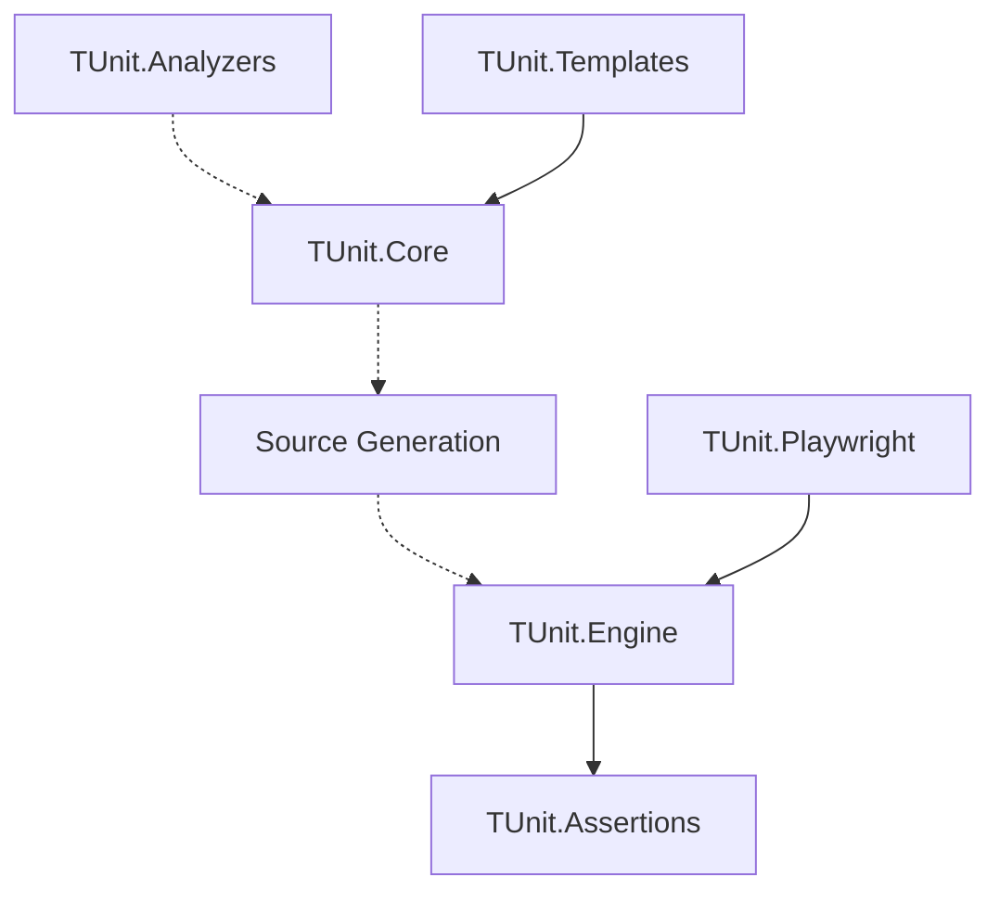

# thomhurst/TUnit

> Framework de tests .NET à découverte par générateur de sources, pour les développeurs C#, F# et VB.

## Le problème
Les frameworks de tests .NET classiques découvrent les tests par réflexion à l'exécution, ce qui ralentit le démarrage et gêne le Native AOT.

## Ce que ça fait vraiment
Un générateur de sources enregistre les tests à la compilation. Les tests tournent en parallèle par défaut, avec `[DependsOn]`, `[NotInParallel]` et `[ParallelLimiter]` pour l'ordre. Il fournit des assertions asynchrones, des fixtures partagées avec injection, des hooks de cycle de vie et une bibliothèque de mocks générée. Des analyseurs Roslyn font échouer le build sur les erreurs d'usage.

## Comment c'est branché


## Essayer
```bash
dotnet new install TUnit.Templates
dotnet new TUnit -n "MyTestProject"
cd MyTestProject
dotnet run
# ou, dans un projet existant :
dotnet add package TUnit
```

## Coût et pièges
Gratuit, sous licence MIT. Il faut un SDK .NET ; les mesures du README tournent sur .NET 10. Les tests utilisent des attributs propres à TUnit : la migration depuis xUnit, NUnit ou MSTest demande des guides.

## Ce que ce n'est pas
Pas un outil de test Python ou ML. Les chiffres de performance viennent du benchmark de l'auteur, régénéré chaque semaine. Les mocks sont fournis, mais ce n'est pas un framework de mocking universel hors .NET.

## Alternatives
- xUnit v3 : plus répandu, découverte par réflexion.
- NUnit : cité dans le comparatif du README.
- MSTest : cité dans le comparatif du README.

## Pour toi
À ignorer : c'est un outil .NET sans lien avec un travail data, IA ou MLOps, il ne vaut que si tu écris du C#.

