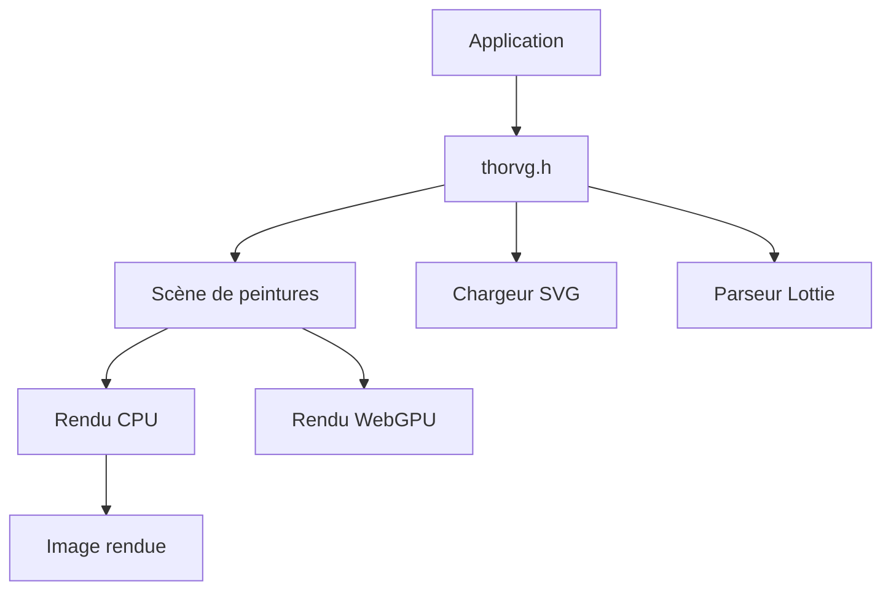

# thorvg/thorvg

> Lightweight C++ vector graphics engine, with SVG and Lottie rendering, from microcontroller to web.

## The problem
Displaying vector animations on low-resource devices without embedding a heavy graphics engine.

## What it actually does
A public API builds a scene graph, loaders read SVG, Lottie and images, then a rendering engine (CPU with SIMD, OpenGL, WebGL, WebGPU) rasterizes. The core can shrink to about 170 KB. C bindings and several related projects exist.

## How it is wired


## Trying it
```bash
meson setup builddir
ninja -C builddir install
meson setup builddir -Dloaders="lottie, ..."
meson setup builddir -Dbindings="capi"
```

## Cost and gotchas
Free (MIT). Meson and Ninja are required; WebGPU requires wgpu-native. The speed comparisons are internal measurements, on Apple M1/M2.

## What it is not
Not a drawing tool nor a final player: it is an engine to integrate. Lottie expressions are disabled by default.

## Alternatives
Skia, mentioned in the README as a performance comparison point.

## For you
Ignore: graphics engine for interfaces and games, unrelated to a data / AI / MLOps profile.
